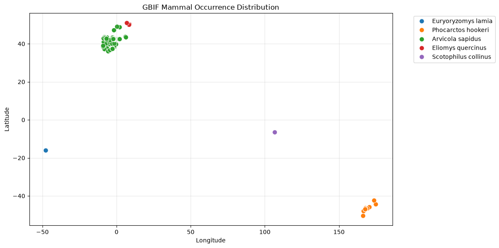
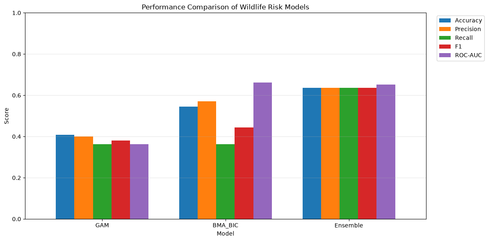
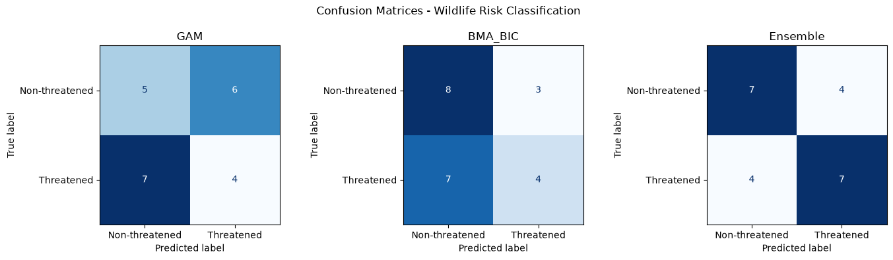
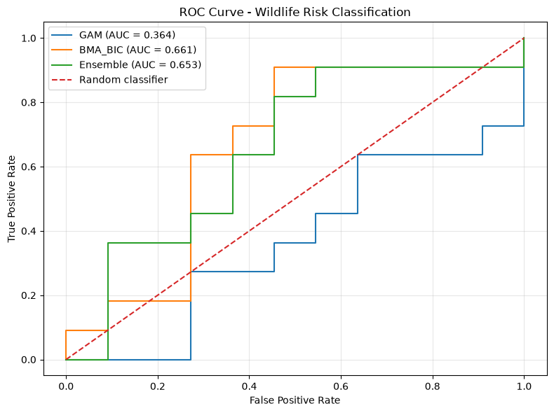
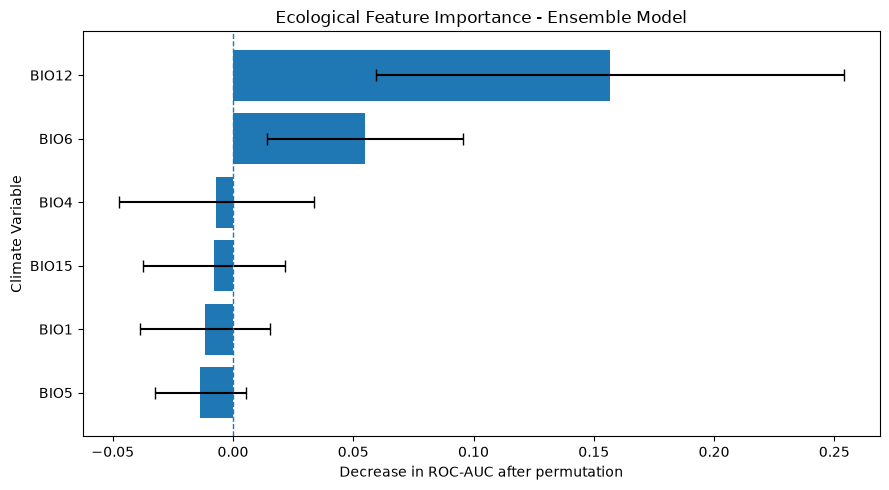

```python
from pathlib import Path
from dotenv import load_dotenv, dotenv_values
import os

PROJECT_DIR = Path(r"D:\wildlife")
ENV_PATH = PROJECT_DIR / ".env"

print("Environment file exists:", ENV_PATH.exists())

# Read the environment file without displaying secrets
config = dotenv_values(ENV_PATH)

print("Variables found:", list(config.keys()))
print("IUCN_API_KEY present:", bool(config.get("IUCN_API_KEY")))

# Load environment variables
load_dotenv(ENV_PATH, override=True)

API_KEY = os.getenv("IUCN_API_KEY")

print("Token loaded:", bool(API_KEY))
print("Token length:", len(API_KEY) if API_KEY else 0)
```

    Environment file exists: True
    Variables found: ['IUCN_API_KEY']
    IUCN_API_KEY present: True
    Token loaded: True
    Token length: 41
    


```python
BASE_URL = "https://api.iucnredlist.org/api/v4"

headers = {
    "Authorization": f"Bearer {API_KEY}",
    "Accept": "application/json"
}

url = f"{BASE_URL}/information/red_list_version"

response = requests.get(
    url,
    headers=headers,
    timeout=30
)

print("HTTP Status:", response.status_code)

if response.status_code == 200:
    print("Authentication successful!")
    print("IUCN Red List version:", response.json())

elif response.status_code == 401:
    print("Authentication failed. Check your API token.")

elif response.status_code == 403:
    print("Access forbidden. Check your API permissions.")

else:
    print("API error:", response.text[:500])
```

    HTTP Status: 200
    Authentication successful!
    IUCN Red List version: {'red_list_version': '2026-1'}
    


```python
import requests
import json

url = f"{BASE_URL}/taxa/class/Mammalia"

response = requests.get(
    url,
    headers=headers,
    params={"page": 1},
    timeout=60
)

print("HTTP Status:", response.status_code)

response.raise_for_status()

mammal_data = response.json()

print("\nResponse keys:")
print(list(mammal_data.keys()))

print("\nResponse preview:")
print(json.dumps(mammal_data, indent=2)[:4000])
```

    HTTP Status: 200
    
    Response keys:
    ['assessments', 'filters']
    
    Response preview:
    {
      "assessments": [
        {
          "assessment_date": "2016-08-11T01:00:00.000+01:00",
          "year_published": "2016",
          "latest": false,
          "possibly_extinct": false,
          "possibly_extinct_in_the_wild": false,
          "sis_taxon_id": 11481,
          "criteria": null,
          "url": "https://www.iucnredlist.org/species/11481/503146",
          "taxon_scientific_name": "Lemmus lemmus",
          "red_list_category_code": "LC",
          "assessment_id": 503146,
          "scopes": [
            {
              "description": {
                "en": "Global"
              },
              "code": "1"
            },
            {
              "description": {
                "en": "Europe"
              },
              "code": "2"
            }
          ]
        },
        {
          "assessment_date": "2018-06-01T01:00:00.000+01:00",
          "year_published": "2019",
          "latest": false,
          "possibly_extinct": false,
          "possibly_extinct_in_the_wild": false,
          "sis_taxon_id": 11797,
          "criteria": "B1ab(v)",
          "url": "https://www.iucnredlist.org/species/11797/503908",
          "taxon_scientific_name": "Lepus castroviejoi",
          "red_list_category_code": "VU",
          "assessment_id": 503908,
          "scopes": [
            {
              "description": {
                "en": "Global"
              },
              "code": "1"
            },
            {
              "description": {
                "en": "Europe"
              },
              "code": "2"
            },
            {
              "description": {
                "en": "Mediterranean"
              },
              "code": "4"
            }
          ]
        },
        {
          "assessment_date": "2011-06-30T01:00:00.000+01:00",
          "year_published": "2012",
          "latest": false,
          "possibly_extinct": false,
          "possibly_extinct_in_the_wild": false,
          "sis_taxon_id": 12817,
          "criteria": null,
          "url": "https://www.iucnredlist.org/species/12817/509971",
          "taxon_scientific_name": "Marmosops cracens",
          "red_list_category_code": "DD",
          "assessment_id": 509971,
          "scopes": [
            {
              "description": {
                "en": "Global"
              },
              "code": "1"
            }
          ]
        },
        {
          "assessment_date": "2016-02-18T00:00:00.000+00:00",
          "year_published": "2016",
          "latest": false,
          "possibly_extinct": false,
          "possibly_extinct_in_the_wild": false,
          "sis_taxon_id": 12835,
          "criteria": null,
          "url": "https://www.iucnredlist.org/species/12835/510082",
          "taxon_scientific_name": "Marmota marmota",
          "red_list_category_code": "LC",
          "assessment_id": 510082,
          "scopes": [
            {
              "description": {
                "en": "Global"
              },
              "code": "1"
            },
            {
              "description": {
                "en": "Europe"
              },
              "code": "2"
            }
          ]
        },
        {
          "assessment_date": "2018-06-19T01:00:00.000+01:00",
          "year_published": "2019",
          "latest": false,
          "possibly_extinct": false,
          "possibly_extinct_in_the_wild": false,
          "sis_taxon_id": 13462,
          "criteria": null,
          "url": "https://www.iucnredlist.org/species/13462/513175",
          "taxon_scientific_name": "Microtus felteni",
          "red_list_category_code": "LC",
          "assessment_id": 513175,
          "scopes": [
            {
              "description": {
                "en": "Global"
              },
              "code": "1"
            },
            {
              "description": {
                "en": "Europe"
              },
              "code": "2"
            },
            {
              "description": {
                "en": "Mediterranean"
              },
              "code": "4"
            }
          ]
        },
        {
          "assessment_date": "2016-09-03T01:00:00.000+01:00",
          "year_published": "2016",
          "latest": false,
          "possibly_extinct": false,
          "possibly_extinct_in_the_wild": false,
          "sis_taxon_id": 13486,
          "criteria": null,
          "url": "https://www.iucnredlist.org/species/13486/513559",
          "taxon_scientific_name": "Microtus thomasi",
          "red_list_category_code": "LC",
          "asses
    


```python
assessments = mammal_data.get("assessments", [])

print("Assessments retrieved:", len(assessments))

if assessments:
    print("\nAvailable assessment fields:")
    print(list(assessments[0].keys()))

    print("\nFirst assessment:")
    display(pd.json_normalize(assessments).head())
else:
    print("No assessments found. Inspect the API response.")
```

    Assessments retrieved: 100
    
    Available assessment fields:
    ['assessment_date', 'year_published', 'latest', 'possibly_extinct', 'possibly_extinct_in_the_wild', 'sis_taxon_id', 'criteria', 'url', 'taxon_scientific_name', 'red_list_category_code', 'assessment_id', 'scopes']
    
    First assessment:
    


<div>
<style scoped>
    .dataframe tbody tr th:only-of-type {
        vertical-align: middle;
    }

    .dataframe tbody tr th {
        vertical-align: top;
    }

    .dataframe thead th {
        text-align: right;
    }
</style>
<table border="1" class="dataframe">
  <thead>
    <tr style="text-align: right;">
      <th></th>
      <th>assessment_date</th>
      <th>year_published</th>
      <th>latest</th>
      <th>possibly_extinct</th>
      <th>possibly_extinct_in_the_wild</th>
      <th>sis_taxon_id</th>
      <th>criteria</th>
      <th>url</th>
      <th>taxon_scientific_name</th>
      <th>red_list_category_code</th>
      <th>assessment_id</th>
      <th>scopes</th>
    </tr>
  </thead>
  <tbody>
    <tr>
      <th>0</th>
      <td>2016-08-11T01:00:00.000+01:00</td>
      <td>2016</td>
      <td>False</td>
      <td>False</td>
      <td>False</td>
      <td>11481</td>
      <td>NaN</td>
      <td>https://www.iucnredlist.org/species/11481/503146</td>
      <td>Lemmus lemmus</td>
      <td>LC</td>
      <td>503146</td>
      <td>[{'description': {'en': 'Global'}, 'code': '1'...</td>
    </tr>
    <tr>
      <th>1</th>
      <td>2018-06-01T01:00:00.000+01:00</td>
      <td>2019</td>
      <td>False</td>
      <td>False</td>
      <td>False</td>
      <td>11797</td>
      <td>B1ab(v)</td>
      <td>https://www.iucnredlist.org/species/11797/503908</td>
      <td>Lepus castroviejoi</td>
      <td>VU</td>
      <td>503908</td>
      <td>[{'description': {'en': 'Global'}, 'code': '1'...</td>
    </tr>
    <tr>
      <th>2</th>
      <td>2011-06-30T01:00:00.000+01:00</td>
      <td>2012</td>
      <td>False</td>
      <td>False</td>
      <td>False</td>
      <td>12817</td>
      <td>NaN</td>
      <td>https://www.iucnredlist.org/species/12817/509971</td>
      <td>Marmosops cracens</td>
      <td>DD</td>
      <td>509971</td>
      <td>[{'description': {'en': 'Global'}, 'code': '1'}]</td>
    </tr>
    <tr>
      <th>3</th>
      <td>2016-02-18T00:00:00.000+00:00</td>
      <td>2016</td>
      <td>False</td>
      <td>False</td>
      <td>False</td>
      <td>12835</td>
      <td>NaN</td>
      <td>https://www.iucnredlist.org/species/12835/510082</td>
      <td>Marmota marmota</td>
      <td>LC</td>
      <td>510082</td>
      <td>[{'description': {'en': 'Global'}, 'code': '1'...</td>
    </tr>
    <tr>
      <th>4</th>
      <td>2018-06-19T01:00:00.000+01:00</td>
      <td>2019</td>
      <td>False</td>
      <td>False</td>
      <td>False</td>
      <td>13462</td>
      <td>NaN</td>
      <td>https://www.iucnredlist.org/species/13462/513175</td>
      <td>Microtus felteni</td>
      <td>LC</td>
      <td>513175</td>
      <td>[{'description': {'en': 'Global'}, 'code': '1'...</td>
    </tr>
  </tbody>
</table>
</div>


```python
url = f"{BASE_URL}/taxa/class/Mammalia"

params = {
    "page": 1,
    "latest": "true",
    "scope_code": 1
}

response = requests.get(
    url,
    headers=headers,
    params=params,
    timeout=60
)

print("HTTP Status:", response.status_code)
response.raise_for_status()

filtered_data = response.json()

filtered_assessments = filtered_data.get("assessments", [])

print("Filtered assessments:", len(filtered_assessments))

filtered_df = pd.json_normalize(filtered_assessments)

display(filtered_df.head())
```

    HTTP Status: 200
    Filtered assessments: 100
    


<div>
<style scoped>
    .dataframe tbody tr th:only-of-type {
        vertical-align: middle;
    }

    .dataframe tbody tr th {
        vertical-align: top;
    }

    .dataframe thead th {
        text-align: right;
    }
</style>
<table border="1" class="dataframe">
  <thead>
    <tr style="text-align: right;">
      <th></th>
      <th>assessment_date</th>
      <th>year_published</th>
      <th>latest</th>
      <th>possibly_extinct</th>
      <th>possibly_extinct_in_the_wild</th>
      <th>sis_taxon_id</th>
      <th>criteria</th>
      <th>url</th>
      <th>taxon_scientific_name</th>
      <th>red_list_category_code</th>
      <th>assessment_id</th>
      <th>scopes</th>
    </tr>
  </thead>
  <tbody>
    <tr>
      <th>0</th>
      <td>2016-04-25T01:00:00.000+01:00</td>
      <td>2016</td>
      <td>True</td>
      <td>False</td>
      <td>False</td>
      <td>136680</td>
      <td>NaN</td>
      <td>https://www.iucnredlist.org/species/136680/518740</td>
      <td>Myotis alcathoe</td>
      <td>DD</td>
      <td>518740</td>
      <td>[{'description': {'en': 'Global'}, 'code': '1'...</td>
    </tr>
    <tr>
      <th>1</th>
      <td>2017-02-28T00:00:00.000+00:00</td>
      <td>2018</td>
      <td>True</td>
      <td>False</td>
      <td>False</td>
      <td>15602</td>
      <td>B2ab(i,iii)</td>
      <td>https://www.iucnredlist.org/species/15602/739675</td>
      <td>Euryoryzomys lamia</td>
      <td>VU</td>
      <td>739675</td>
      <td>[{'description': {'en': 'Global'}, 'code': '1'}]</td>
    </tr>
    <tr>
      <th>2</th>
      <td>2014-11-18T00:00:00.000+00:00</td>
      <td>2015</td>
      <td>True</td>
      <td>False</td>
      <td>False</td>
      <td>17026</td>
      <td>A4bd</td>
      <td>https://www.iucnredlist.org/species/17026/1306343</td>
      <td>Phocarctos hookeri</td>
      <td>EN</td>
      <td>1306343</td>
      <td>[{'description': {'en': 'Global'}, 'code': '1'}]</td>
    </tr>
    <tr>
      <th>3</th>
      <td>2023-02-27T00:00:00.000+00:00</td>
      <td>2024</td>
      <td>True</td>
      <td>False</td>
      <td>False</td>
      <td>2150</td>
      <td>A2ace</td>
      <td>https://www.iucnredlist.org/species/2150/2775649</td>
      <td>Arvicola sapidus</td>
      <td>NT</td>
      <td>2775649</td>
      <td>[{'description': {'en': 'Global'}, 'code': '1'...</td>
    </tr>
    <tr>
      <th>4</th>
      <td>2023-02-27T00:00:00.000+00:00</td>
      <td>2024</td>
      <td>True</td>
      <td>False</td>
      <td>False</td>
      <td>7618</td>
      <td>A2c</td>
      <td>https://www.iucnredlist.org/species/7618/3139783</td>
      <td>Eliomys quercinus</td>
      <td>VU</td>
      <td>3139783</td>
      <td>[{'description': {'en': 'Global'}, 'code': '1'...</td>
    </tr>
  </tbody>
</table>
</div>


```python
import time
from pathlib import Path

OUTPUT_DIR = Path(r"D:\wildlife\datasets\iucn")
OUTPUT_DIR.mkdir(parents=True, exist_ok=True)

CSV_PATH = OUTPUT_DIR / "iucn_mammals.csv"

all_assessments = []

page = 1
page_size = 100

while True:

    print(f"Downloading page {page}...")

    params = {
        "page": page,
        "latest": "true",
        "scope_code": 1
    }

    try:
        response = requests.get(
            f"{BASE_URL}/taxa/class/Mammalia",
            headers=headers,
            params=params,
            timeout=60
        )

        response.raise_for_status()

        data = response.json()

        records = data.get("assessments", [])

        if not records:
            print("No more records.")
            break

        all_assessments.extend(records)

        # Save progress after every page
        temp_df = pd.json_normalize(all_assessments)

        temp_df.to_csv(
            CSV_PATH,
            index=False
        )

        print(
            f"Page {page}: {len(records)} records | "
            f"Total: {len(all_assessments)}"
        )

        if len(records) < page_size:
            break

        page += 1

        # Respect API server resources
        time.sleep(1)

    except requests.exceptions.RequestException as e:

        print("Download interrupted:", e)
        print("Successfully downloaded records are saved.")
        break

print("\nDownload process finished.")
print("Total records:", len(all_assessments))
print("Saved at:", CSV_PATH)
```

    Downloading page 1...
    Page 1: 100 records | Total: 100
    Downloading page 2...
    Page 2: 100 records | Total: 200
    Downloading page 3...
    Page 3: 100 records | Total: 300
    Downloading page 4...
    Page 4: 100 records | Total: 400
    Downloading page 5...
    Page 5: 100 records | Total: 500
    Downloading page 6...
    Page 6: 100 records | Total: 600
    Downloading page 7...
    Page 7: 100 records | Total: 700
    Downloading page 8...
    Page 8: 100 records | Total: 800
    Downloading page 9...
    Page 9: 100 records | Total: 900
    Downloading page 10...
    Page 10: 100 records | Total: 1000
    Downloading page 11...
    Page 11: 100 records | Total: 1100
    Downloading page 12...
    Page 12: 100 records | Total: 1200
    Downloading page 13...
    Page 13: 100 records | Total: 1300
    Downloading page 14...
    Page 14: 100 records | Total: 1400
    Downloading page 15...
    Page 15: 100 records | Total: 1500
    Downloading page 16...
    Page 16: 100 records | Total: 1600
    Downloading page 17...
    Page 17: 100 records | Total: 1700
    Downloading page 18...
    Page 18: 100 records | Total: 1800
    Downloading page 19...
    Page 19: 100 records | Total: 1900
    Downloading page 20...
    Page 20: 100 records | Total: 2000
    Downloading page 21...
    Page 21: 100 records | Total: 2100
    Downloading page 22...
    Page 22: 100 records | Total: 2200
    Downloading page 23...
    Page 23: 100 records | Total: 2300
    Downloading page 24...
    Page 24: 100 records | Total: 2400
    Downloading page 25...
    Page 25: 100 records | Total: 2500
    Downloading page 26...
    Page 26: 100 records | Total: 2600
    Downloading page 27...
    Page 27: 100 records | Total: 2700
    Downloading page 28...
    Page 28: 100 records | Total: 2800
    Downloading page 29...
    Page 29: 100 records | Total: 2900
    Downloading page 30...
    Page 30: 100 records | Total: 3000
    Downloading page 31...
    Page 31: 100 records | Total: 3100
    Downloading page 32...
    Page 32: 100 records | Total: 3200
    Downloading page 33...
    Page 33: 100 records | Total: 3300
    Downloading page 34...
    Page 34: 100 records | Total: 3400
    Downloading page 35...
    Page 35: 100 records | Total: 3500
    Downloading page 36...
    Page 36: 100 records | Total: 3600
    Downloading page 37...
    Page 37: 100 records | Total: 3700
    Downloading page 38...
    Page 38: 100 records | Total: 3800
    Downloading page 39...
    Page 39: 100 records | Total: 3900
    Downloading page 40...
    Page 40: 100 records | Total: 4000
    Downloading page 41...
    Page 41: 100 records | Total: 4100
    Downloading page 42...
    Page 42: 100 records | Total: 4200
    Downloading page 43...
    Page 43: 100 records | Total: 4300
    Downloading page 44...
    Page 44: 100 records | Total: 4400
    Downloading page 45...
    Page 45: 100 records | Total: 4500
    Downloading page 46...
    Page 46: 100 records | Total: 4600
    Downloading page 47...
    Page 47: 100 records | Total: 4700
    Downloading page 48...
    Page 48: 100 records | Total: 4800
    Downloading page 49...
    Page 49: 100 records | Total: 4900
    Downloading page 50...
    Page 50: 100 records | Total: 5000
    Downloading page 51...
    Page 51: 100 records | Total: 5100
    Downloading page 52...
    Page 52: 100 records | Total: 5200
    Downloading page 53...
    Page 53: 100 records | Total: 5300
    Downloading page 54...
    Page 54: 100 records | Total: 5400
    Downloading page 55...
    Page 55: 100 records | Total: 5500
    Downloading page 56...
    Page 56: 100 records | Total: 5600
    Downloading page 57...
    Page 57: 100 records | Total: 5700
    Downloading page 58...
    Page 58: 100 records | Total: 5800
    Downloading page 59...
    Page 59: 100 records | Total: 5900
    Downloading page 60...
    Page 60: 100 records | Total: 6000
    Downloading page 61...
    Page 61: 54 records | Total: 6054
    
    Download process finished.
    Total records: 6054
    Saved at: D:\wildlife\datasets\iucn\iucn_mammals.csv
    


```python
iucn_df = pd.read_csv(CSV_PATH)

print("Dataset shape:", iucn_df.shape)

print("\nConservation categories:")
print(iucn_df["red_list_category_code"].value_counts())

print("\nLatest assessment check:")
print(iucn_df["latest"].value_counts())

print("\nMissing values:")
print(iucn_df.isnull().sum())

print("\nUnique species:",
      iucn_df["sis_taxon_id"].nunique())

display(
    iucn_df[
        [
            "taxon_scientific_name",
            "red_list_category_code",
            "assessment_id",
            "assessment_date",
            "year_published"
        ]
    ].head(10)
)
```

    Dataset shape: (6054, 12)
    
    Conservation categories:
    red_list_category_code
    LC       3407
    DD        773
    VU        571
    EN        565
    NT        404
    CR        236
    EX         96
    LR/nt       1
    EW          1
    Name: count, dtype: int64
    
    Latest assessment check:
    latest
    True    6054
    Name: count, dtype: int64
    
    Missing values:
    assessment_date                    0
    year_published                     0
    latest                             0
    possibly_extinct                   0
    possibly_extinct_in_the_wild       0
    sis_taxon_id                       0
    criteria                        4401
    url                                0
    taxon_scientific_name              0
    red_list_category_code             0
    assessment_id                      0
    scopes                             0
    dtype: int64
    
    Unique species: 6054
    


<div>
<style scoped>
    .dataframe tbody tr th:only-of-type {
        vertical-align: middle;
    }

    .dataframe tbody tr th {
        vertical-align: top;
    }

    .dataframe thead th {
        text-align: right;
    }
</style>
<table border="1" class="dataframe">
  <thead>
    <tr style="text-align: right;">
      <th></th>
      <th>taxon_scientific_name</th>
      <th>red_list_category_code</th>
      <th>assessment_id</th>
      <th>assessment_date</th>
      <th>year_published</th>
    </tr>
  </thead>
  <tbody>
    <tr>
      <th>0</th>
      <td>Myotis alcathoe</td>
      <td>DD</td>
      <td>518740</td>
      <td>2016-04-25T01:00:00.000+01:00</td>
      <td>2016</td>
    </tr>
    <tr>
      <th>1</th>
      <td>Euryoryzomys lamia</td>
      <td>VU</td>
      <td>739675</td>
      <td>2017-02-28T00:00:00.000+00:00</td>
      <td>2018</td>
    </tr>
    <tr>
      <th>2</th>
      <td>Phocarctos hookeri</td>
      <td>EN</td>
      <td>1306343</td>
      <td>2014-11-18T00:00:00.000+00:00</td>
      <td>2015</td>
    </tr>
    <tr>
      <th>3</th>
      <td>Arvicola sapidus</td>
      <td>NT</td>
      <td>2775649</td>
      <td>2023-02-27T00:00:00.000+00:00</td>
      <td>2024</td>
    </tr>
    <tr>
      <th>4</th>
      <td>Eliomys quercinus</td>
      <td>VU</td>
      <td>3139783</td>
      <td>2023-02-27T00:00:00.000+00:00</td>
      <td>2024</td>
    </tr>
    <tr>
      <th>5</th>
      <td>Nycticeius aenobarbus</td>
      <td>DD</td>
      <td>4311281</td>
      <td>2008-06-30T01:00:00.000+01:00</td>
      <td>2008</td>
    </tr>
    <tr>
      <th>6</th>
      <td>Scotophilus collinus</td>
      <td>LC</td>
      <td>4318302</td>
      <td>2008-06-30T01:00:00.000+01:00</td>
      <td>2008</td>
    </tr>
    <tr>
      <th>7</th>
      <td>Naemorhedus goral</td>
      <td>NT</td>
      <td>4430073</td>
      <td>2008-06-30T01:00:00.000+01:00</td>
      <td>2008</td>
    </tr>
    <tr>
      <th>8</th>
      <td>Ovis nivicola</td>
      <td>LC</td>
      <td>5076357</td>
      <td>2008-06-30T01:00:00.000+01:00</td>
      <td>2008</td>
    </tr>
    <tr>
      <th>9</th>
      <td>Rhinolophus cornutus</td>
      <td>LR/nt</td>
      <td>8957242</td>
      <td>1996-08-01T01:00:00.000+01:00</td>
      <td>1996</td>
    </tr>
  </tbody>
</table>
</div>


```python
# Work on a copy of the original dataset
iucn_clean = iucn_df.copy()

# Normalize legacy category
iucn_clean["red_list_category_code"] = (
    iucn_clean["red_list_category_code"]
    .replace({"LR/nt": "NT"})
)

# Keep only categories suitable for binary classification
valid_categories = ["LC", "NT", "VU", "EN", "CR"]

iucn_clean = iucn_clean[
    iucn_clean["red_list_category_code"].isin(valid_categories)
].copy()

# Create binary risk target
iucn_clean["risk_target"] = (
    iucn_clean["red_list_category_code"]
    .isin(["VU", "EN", "CR"])
).astype(int)

# Rename columns
iucn_clean.rename(columns={
    "taxon_scientific_name": "scientific_name",
    "red_list_category_code": "category",
    "sis_taxon_id": "species_id"
}, inplace=True)

print("Cleaned dataset shape:", iucn_clean.shape)

print("\nRisk distribution:")
print(iucn_clean["risk_target"].value_counts())

print("\nCategory distribution:")
print(iucn_clean["category"].value_counts())

display(iucn_clean.head())
```

    Cleaned dataset shape: (5184, 13)
    
    Risk distribution:
    risk_target
    0    3812
    1    1372
    Name: count, dtype: int64
    
    Category distribution:
    category
    LC    3407
    VU     571
    EN     565
    NT     405
    CR     236
    Name: count, dtype: int64
    


<div>
<style scoped>
    .dataframe tbody tr th:only-of-type {
        vertical-align: middle;
    }

    .dataframe tbody tr th {
        vertical-align: top;
    }

    .dataframe thead th {
        text-align: right;
    }
</style>
<table border="1" class="dataframe">
  <thead>
    <tr style="text-align: right;">
      <th></th>
      <th>assessment_date</th>
      <th>year_published</th>
      <th>latest</th>
      <th>possibly_extinct</th>
      <th>possibly_extinct_in_the_wild</th>
      <th>species_id</th>
      <th>criteria</th>
      <th>url</th>
      <th>scientific_name</th>
      <th>category</th>
      <th>assessment_id</th>
      <th>scopes</th>
      <th>risk_target</th>
    </tr>
  </thead>
  <tbody>
    <tr>
      <th>1</th>
      <td>2017-02-28T00:00:00.000+00:00</td>
      <td>2018</td>
      <td>True</td>
      <td>False</td>
      <td>False</td>
      <td>15602</td>
      <td>B2ab(i,iii)</td>
      <td>https://www.iucnredlist.org/species/15602/739675</td>
      <td>Euryoryzomys lamia</td>
      <td>VU</td>
      <td>739675</td>
      <td>[{'description': {'en': 'Global'}, 'code': '1'}]</td>
      <td>1</td>
    </tr>
    <tr>
      <th>2</th>
      <td>2014-11-18T00:00:00.000+00:00</td>
      <td>2015</td>
      <td>True</td>
      <td>False</td>
      <td>False</td>
      <td>17026</td>
      <td>A4bd</td>
      <td>https://www.iucnredlist.org/species/17026/1306343</td>
      <td>Phocarctos hookeri</td>
      <td>EN</td>
      <td>1306343</td>
      <td>[{'description': {'en': 'Global'}, 'code': '1'}]</td>
      <td>1</td>
    </tr>
    <tr>
      <th>3</th>
      <td>2023-02-27T00:00:00.000+00:00</td>
      <td>2024</td>
      <td>True</td>
      <td>False</td>
      <td>False</td>
      <td>2150</td>
      <td>A2ace</td>
      <td>https://www.iucnredlist.org/species/2150/2775649</td>
      <td>Arvicola sapidus</td>
      <td>NT</td>
      <td>2775649</td>
      <td>[{'description': {'en': 'Global'}, 'code': '1'...</td>
      <td>0</td>
    </tr>
    <tr>
      <th>4</th>
      <td>2023-02-27T00:00:00.000+00:00</td>
      <td>2024</td>
      <td>True</td>
      <td>False</td>
      <td>False</td>
      <td>7618</td>
      <td>A2c</td>
      <td>https://www.iucnredlist.org/species/7618/3139783</td>
      <td>Eliomys quercinus</td>
      <td>VU</td>
      <td>3139783</td>
      <td>[{'description': {'en': 'Global'}, 'code': '1'...</td>
      <td>1</td>
    </tr>
    <tr>
      <th>6</th>
      <td>2008-06-30T01:00:00.000+01:00</td>
      <td>2008</td>
      <td>True</td>
      <td>False</td>
      <td>False</td>
      <td>136612</td>
      <td>NaN</td>
      <td>https://www.iucnredlist.org/species/136612/431...</td>
      <td>Scotophilus collinus</td>
      <td>LC</td>
      <td>4318302</td>
      <td>[{'description': {'en': 'Global'}, 'code': '1'}]</td>
      <td>0</td>
    </tr>
  </tbody>
</table>
</div>


```python
from pathlib import Path

PROJECT_DIR = Path(r"D:\wildlife")

OUTPUT_DIR = PROJECT_DIR / "datasets" / "iucn"

OUTPUT_DIR.mkdir(parents=True, exist_ok=True)

print("Output directory:", OUTPUT_DIR)
print("Directory exists:", OUTPUT_DIR.exists())
```

    Output directory: D:\wildlife\datasets\iucn
    Directory exists: True
    


```python
import pandas as pd
from pathlib import Path

PROJECT_DIR = Path(r"D:\wildlife")

OUTPUT_DIR = PROJECT_DIR / "datasets" / "iucn"
OUTPUT_DIR.mkdir(parents=True, exist_ok=True)

RAW_PATH = OUTPUT_DIR / "iucn_mammals.csv"

iucn_df = pd.read_csv(RAW_PATH)

print("Original dataset loaded:", iucn_df.shape)
```

    Original dataset loaded: (6054, 12)
    


```python
iucn_clean = iucn_df.copy()

iucn_clean["red_list_category_code"] = (
    iucn_clean["red_list_category_code"]
    .replace({"LR/nt": "NT"})
)

valid_categories = ["LC", "NT", "VU", "EN", "CR"]

iucn_clean = iucn_clean[
    iucn_clean["red_list_category_code"].isin(valid_categories)
].copy()

iucn_clean["risk_target"] = (
    iucn_clean["red_list_category_code"]
    .isin(["VU", "EN", "CR"])
).astype(int)

iucn_clean.rename(columns={
    "taxon_scientific_name": "scientific_name",
    "red_list_category_code": "category",
    "sis_taxon_id": "species_id"
}, inplace=True)

print("Cleaned dataset:", iucn_clean.shape)
print(iucn_clean["risk_target"].value_counts())
```

    Cleaned dataset: (5184, 13)
    risk_target
    0    3812
    1    1372
    Name: count, dtype: int64
    


```python
CLEAN_PATH = OUTPUT_DIR / "iucn_mammals_cleaned.csv"

iucn_clean.to_csv(CLEAN_PATH, index=False)

print("Saved successfully:", CLEAN_PATH)
print("Final shape:", iucn_clean.shape)
```

    Saved successfully: D:\wildlife\datasets\iucn\iucn_mammals_cleaned.csv
    Final shape: (5184, 13)
    


```python
import pandas as pd
import requests
import time
from pathlib import Path

PROJECT_DIR = Path(r"D:\wildlife")

CLEAN_PATH = (
    PROJECT_DIR / "datasets" / "iucn"
    / "iucn_mammals_cleaned.csv"
)

GBIF_DIR = PROJECT_DIR / "datasets" / "gbif"
GBIF_DIR.mkdir(parents=True, exist_ok=True)

iucn_clean = pd.read_csv(CLEAN_PATH)

print("IUCN species loaded:", len(iucn_clean))
print("GBIF output directory:", GBIF_DIR)
```

    IUCN species loaded: 5184
    GBIF output directory: D:\wildlife\datasets\gbif
    


```python
GBIF_BASE_URL = "https://api.gbif.org/v1"

gbif_session = requests.Session()

gbif_session.headers.update({
    "User-Agent": "WildlifeSpeciesRiskAssessment/1.0"
})

print("GBIF API configured successfully!")
```

    GBIF API configured successfully!
    


```python
def match_gbif_species(species_name):

    try:
        response = gbif_session.get(
            f"{GBIF_BASE_URL}/species/match",
            params={"name": species_name},
            timeout=30
        )

        response.raise_for_status()
        data = response.json()

        return {
            "requested_name": species_name,
            "gbif_name": data.get("scientificName"),
            "taxon_key": data.get("usageKey"),
            "match_type": data.get("matchType"),
            "rank": data.get("rank"),
            "status": data.get("status")
        }

    except requests.RequestException as e:
        print(f"Error matching {species_name}: {e}")
        return None
```


```python
sample_species = (
    iucn_clean["scientific_name"]
    .drop_duplicates()
    .head(5)
    .tolist()
)

matches = []

for species in sample_species:

    result = match_gbif_species(species)

    if result:
        matches.append(result)

    time.sleep(0.3)

gbif_matches = pd.DataFrame(matches)

display(gbif_matches)

print("Species tested:", len(sample_species))
print("Successful matches:", gbif_matches["taxon_key"].notna().sum())
```


<div>
<style scoped>
    .dataframe tbody tr th:only-of-type {
        vertical-align: middle;
    }

    .dataframe tbody tr th {
        vertical-align: top;
    }

    .dataframe thead th {
        text-align: right;
    }
</style>
<table border="1" class="dataframe">
  <thead>
    <tr style="text-align: right;">
      <th></th>
      <th>requested_name</th>
      <th>gbif_name</th>
      <th>taxon_key</th>
      <th>match_type</th>
      <th>rank</th>
      <th>status</th>
    </tr>
  </thead>
  <tbody>
    <tr>
      <th>0</th>
      <td>Euryoryzomys lamia</td>
      <td>Euryoryzomys lamia (Thomas, 1901)</td>
      <td>5786859</td>
      <td>EXACT</td>
      <td>SPECIES</td>
      <td>ACCEPTED</td>
    </tr>
    <tr>
      <th>1</th>
      <td>Phocarctos hookeri</td>
      <td>Phocarctos hookeri (Gray, 1844)</td>
      <td>2433467</td>
      <td>EXACT</td>
      <td>SPECIES</td>
      <td>ACCEPTED</td>
    </tr>
    <tr>
      <th>2</th>
      <td>Arvicola sapidus</td>
      <td>Arvicola sapidus Miller, 1908</td>
      <td>2438492</td>
      <td>EXACT</td>
      <td>SPECIES</td>
      <td>ACCEPTED</td>
    </tr>
    <tr>
      <th>3</th>
      <td>Eliomys quercinus</td>
      <td>Eliomys quercinus (Linnaeus, 1766)</td>
      <td>2439683</td>
      <td>EXACT</td>
      <td>SPECIES</td>
      <td>ACCEPTED</td>
    </tr>
    <tr>
      <th>4</th>
      <td>Scotophilus collinus</td>
      <td>Scotophilus collinus Sody, 1936</td>
      <td>5707087</td>
      <td>EXACT</td>
      <td>SPECIES</td>
      <td>ACCEPTED</td>
    </tr>
  </tbody>
</table>
</div>


    Species tested: 5
    Successful matches: 5
    


```python
MATCH_PATH = GBIF_DIR / "gbif_taxonomy_pilot.csv"

gbif_matches.to_csv(
    MATCH_PATH,
    index=False
)

print("Matching results saved:", MATCH_PATH)
```

    Matching results saved: D:\wildlife\datasets\gbif\gbif_taxonomy_pilot.csv
    


```python
import requests
import time
import pandas as pd

def get_gbif_occurrences(taxon_key, limit=100, max_retries=4):

    for attempt in range(max_retries):

        try:
            response = gbif_session.get(
                f"{GBIF_BASE_URL}/occurrence/search",
                params={
                    "taxonKey": int(taxon_key),
                    "hasCoordinate": "true",
                    "hasGeospatialIssue": "false",
                    "occurrenceStatus": "PRESENT",
                    "limit": limit,
                    "offset": 0
                },
                timeout=(15, 90)
            )

            response.raise_for_status()

            data = response.json()

            return {
                "success": True,
                "total_available": data.get("count", 0),
                "records": data.get("results", []),
                "error": None
            }

        except requests.exceptions.RequestException as e:

            wait_time = 2 ** attempt

            print(
                f"Attempt {attempt + 1}/{max_retries} "
                f"failed for {taxon_key}: {e}"
            )

            if attempt < max_retries - 1:
                print(f"Retrying in {wait_time} seconds...")
                time.sleep(wait_time)

    return {
        "success": False,
        "total_available": None,
        "records": [],
        "error": "Maximum retries exceeded"
    }
```


```python
# Load existing successful records if available
PILOT_PATH = GBIF_DIR / "gbif_mammals_pilot.csv"

if PILOT_PATH.exists():
    existing_records = pd.read_csv(PILOT_PATH)
else:
    existing_records = pd.DataFrame()

# Identify species already downloaded successfully
completed_species = set()

if not existing_records.empty:
    completed_species = set(
        existing_records["scientific_name"].dropna()
    )

new_records = []
retry_summary = []

for _, row in gbif_matches.iterrows():

    species = row["requested_name"]
    taxon_key = row["taxon_key"]

    if species in completed_species:
        print(f"Skipping already downloaded: {species}")
        continue

    print(f"\nRetrieving: {species}")

    result = get_gbif_occurrences(
        taxon_key,
        limit=100,
        max_retries=4
    )

    retry_summary.append({
        "species": species,
        "success": result["success"],
        "available": result["total_available"],
        "downloaded": len(result["records"]),
        "error": result["error"]
    })

    if result["success"]:

        for record in result["records"]:

            new_records.append({
                "scientific_name": species,
                "gbif_species": record.get("species"),
                "taxon_key": taxon_key,
                "gbif_id": record.get("gbifID"),
                "latitude": record.get("decimalLatitude"),
                "longitude": record.get("decimalLongitude"),
                "event_date": record.get("eventDate"),
                "basis_of_record": record.get("basisOfRecord"),
                "country_code": record.get("countryCode"),
                "coordinate_uncertainty": record.get(
                    "coordinateUncertaintyInMeters"
                )
            })

        print(
            f"Success: {len(result['records'])} records"
        )

        # Save progress after each species
        if new_records:
            combined = pd.concat(
                [
                    existing_records,
                    pd.DataFrame(new_records)
                ],
                ignore_index=True
            )

            combined.drop_duplicates(
                subset="gbif_id",
                inplace=True
            )

            combined.to_csv(
                PILOT_PATH,
                index=False
            )

            existing_records = combined
            new_records = []

    else:
        print("Failed after all retries.")

    time.sleep(2)

retry_summary_df = pd.DataFrame(retry_summary)

display(retry_summary_df)

print("\nTotal saved occurrence records:",
      len(existing_records))
```


```python
# Load existing successful records if available
PILOT_PATH = GBIF_DIR / "gbif_mammals_pilot.csv"

if PILOT_PATH.exists():
    existing_records = pd.read_csv(PILOT_PATH)
else:
    existing_records = pd.DataFrame()

# Identify species already downloaded successfully
completed_species = set()

if not existing_records.empty:
    completed_species = set(
        existing_records["scientific_name"].dropna()
    )

new_records = []
retry_summary = []

for _, row in gbif_matches.iterrows():

    species = row["requested_name"]
    taxon_key = row["taxon_key"]

    if species in completed_species:
        print(f"Skipping already downloaded: {species}")
        continue

    print(f"\nRetrieving: {species}")

    result = get_gbif_occurrences(
        taxon_key,
        limit=100,
        max_retries=4
    )

    retry_summary.append({
        "species": species,
        "success": result["success"],
        "available": result["total_available"],
        "downloaded": len(result["records"]),
        "error": result["error"]
    })

    if result["success"]:

        for record in result["records"]:

            new_records.append({
                "scientific_name": species,
                "gbif_species": record.get("species"),
                "taxon_key": taxon_key,
                "gbif_id": record.get("gbifID"),
                "latitude": record.get("decimalLatitude"),
                "longitude": record.get("decimalLongitude"),
                "event_date": record.get("eventDate"),
                "basis_of_record": record.get("basisOfRecord"),
                "country_code": record.get("countryCode"),
                "coordinate_uncertainty": record.get(
                    "coordinateUncertaintyInMeters"
                )
            })

        print(
            f"Success: {len(result['records'])} records"
        )

        # Save progress after each species
        if new_records:
            combined = pd.concat(
                [
                    existing_records,
                    pd.DataFrame(new_records)
                ],
                ignore_index=True
            )

            combined.drop_duplicates(
                subset="gbif_id",
                inplace=True
            )

            combined.to_csv(
                PILOT_PATH,
                index=False
            )

            existing_records = combined
            new_records = []

    else:
        print("Failed after all retries.")

    time.sleep(2)

retry_summary_df = pd.DataFrame(retry_summary)

display(retry_summary_df)

print("\nTotal saved occurrence records:",
      len(existing_records))
```

    
    Retrieving: Euryoryzomys lamia
    Attempt 1/4 failed for 5786859: HTTPSConnectionPool(host='api.gbif.org', port=443): Read timed out. (read timeout=15)
    Retrying in 1 seconds...
    Attempt 2/4 failed for 5786859: HTTPSConnectionPool(host='api.gbif.org', port=443): Read timed out.
    Retrying in 2 seconds...
    Success: 4 records
    
    Retrieving: Phocarctos hookeri
    Attempt 1/4 failed for 2433467: HTTPSConnectionPool(host='api.gbif.org', port=443): Read timed out.
    Retrying in 1 seconds...
    Attempt 2/4 failed for 2433467: HTTPSConnectionPool(host='api.gbif.org', port=443): Read timed out.
    Retrying in 2 seconds...
    Success: 100 records
    
    Retrieving: Arvicola sapidus
    Success: 100 records
    
    Retrieving: Eliomys quercinus
    Attempt 1/4 failed for 2439683: HTTPSConnectionPool(host='api.gbif.org', port=443): Read timed out.
    Retrying in 1 seconds...
    Attempt 2/4 failed for 2439683: ('Connection broken: IncompleteRead(1458176 bytes read, 1114731 more expected)', IncompleteRead(1458176 bytes read, 1114731 more expected))
    Retrying in 2 seconds...
    Attempt 3/4 failed for 2439683: HTTPSConnectionPool(host='api.gbif.org', port=443): Read timed out.
    Retrying in 4 seconds...
    Success: 100 records
    
    Retrieving: Scotophilus collinus
    Success: 1 records
    


<div>
<style scoped>
    .dataframe tbody tr th:only-of-type {
        vertical-align: middle;
    }

    .dataframe tbody tr th {
        vertical-align: top;
    }

    .dataframe thead th {
        text-align: right;
    }
</style>
<table border="1" class="dataframe">
  <thead>
    <tr style="text-align: right;">
      <th></th>
      <th>species</th>
      <th>success</th>
      <th>available</th>
      <th>downloaded</th>
      <th>error</th>
    </tr>
  </thead>
  <tbody>
    <tr>
      <th>0</th>
      <td>Euryoryzomys lamia</td>
      <td>True</td>
      <td>4</td>
      <td>4</td>
      <td>None</td>
    </tr>
    <tr>
      <th>1</th>
      <td>Phocarctos hookeri</td>
      <td>True</td>
      <td>36499</td>
      <td>100</td>
      <td>None</td>
    </tr>
    <tr>
      <th>2</th>
      <td>Arvicola sapidus</td>
      <td>True</td>
      <td>17364</td>
      <td>100</td>
      <td>None</td>
    </tr>
    <tr>
      <th>3</th>
      <td>Eliomys quercinus</td>
      <td>True</td>
      <td>28132</td>
      <td>100</td>
      <td>None</td>
    </tr>
    <tr>
      <th>4</th>
      <td>Scotophilus collinus</td>
      <td>True</td>
      <td>1</td>
      <td>1</td>
      <td>None</td>
    </tr>
  </tbody>
</table>
</div>


    
    Total saved occurrence records: 305
    


```python
gbif_pilot = pd.read_csv(PILOT_PATH)

print("Dataset shape:", gbif_pilot.shape)

print("\nMissing values:")
print(gbif_pilot.isnull().sum())

print("\nDuplicate GBIF IDs:")
print(gbif_pilot["gbif_id"].duplicated().sum())

print("\nRecords per species:")
print(gbif_pilot["scientific_name"].value_counts())
```

    Dataset shape: (305, 10)
    
    Missing values:
    scientific_name            0
    gbif_species               0
    taxon_key                  0
    gbif_id                    0
    latitude                   0
    longitude                  0
    event_date                 0
    basis_of_record            0
    country_code               0
    coordinate_uncertainty    21
    dtype: int64
    
    Duplicate GBIF IDs:
    0
    
    Records per species:
    scientific_name
    Phocarctos hookeri      100
    Arvicola sapidus        100
    Eliomys quercinus       100
    Euryoryzomys lamia        4
    Scotophilus collinus      1
    Name: count, dtype: int64
    


```python
valid_coordinates = gbif_pilot[
    gbif_pilot["latitude"].between(-90, 90) &
    gbif_pilot["longitude"].between(-180, 180)
].copy()

print("Original records:", len(gbif_pilot))
print("Valid coordinates:", len(valid_coordinates))
print("Invalid coordinates:", len(gbif_pilot) - len(valid_coordinates))
```

    Original records: 305
    Valid coordinates: 305
    Invalid coordinates: 0
    


```python
print("Coordinate uncertainty statistics:")

display(
    valid_coordinates[
        "coordinate_uncertainty"
    ].describe()
)

print("\nRecords without uncertainty information:",
      valid_coordinates["coordinate_uncertainty"].isna().sum())
```

    Coordinate uncertainty statistics:
    


    count       284.000000
    mean       4207.704225
    std       29928.014940
    min           1.000000
    25%           8.000000
    50%         250.000000
    75%         250.000000
    max      489734.000000
    Name: coordinate_uncertainty, dtype: float64


    
    Records without uncertainty information: 21
    


```python
import matplotlib.pyplot as plt
import seaborn as sns
```


```python
plt.figure(figsize=(12, 6))

sns.scatterplot(
    data=valid_coordinates,
    x="longitude",
    y="latitude",
    hue="scientific_name",
    s=65
)

plt.title("GBIF Mammal Occurrence Distribution")
plt.xlabel("Longitude")
plt.ylabel("Latitude")
plt.grid(alpha=0.3)
plt.legend(bbox_to_anchor=(1.05, 1), loc="upper left")
plt.tight_layout()
plt.show()
```


    

    


```python
VALIDATED_PATH = GBIF_DIR / "gbif_mammals_validated.csv"

valid_coordinates.to_csv(VALIDATED_PATH, index=False)

print("Validated dataset saved:", VALIDATED_PATH)
print("Total valid records:", len(valid_coordinates))
print("Species represented:", valid_coordinates["scientific_name"].nunique())
```

    Validated dataset saved: D:\wildlife\datasets\gbif\gbif_mammals_validated.csv
    Total valid records: 305
    Species represented: 5
    


```python
print("Records per species:")
display(valid_coordinates["scientific_name"].value_counts())

print("\nCoordinate uncertainty:")
display(valid_coordinates["coordinate_uncertainty"].describe())

print("\nMissing coordinate uncertainty:")
print(valid_coordinates["coordinate_uncertainty"].isna().sum())
```

    Records per species:
    


    scientific_name
    Phocarctos hookeri      100
    Arvicola sapidus        100
    Eliomys quercinus       100
    Euryoryzomys lamia        4
    Scotophilus collinus      1
    Name: count, dtype: int64


    
    Coordinate uncertainty:
    


    count       284.000000
    mean       4207.704225
    std       29928.014940
    min           1.000000
    25%           8.000000
    50%         250.000000
    75%         250.000000
    max      489734.000000
    Name: coordinate_uncertainty, dtype: float64


    
    Missing coordinate uncertainty:
    21
    


```python
# Create a quality-controlled copy of GBIF records

gbif_quality = valid_coordinates.copy()

# Flag records with acceptable coordinate uncertainty
# 10 km is our initial quality threshold
gbif_quality["coordinate_quality"] = (
    gbif_quality["coordinate_uncertainty"].notna()
    & (gbif_quality["coordinate_uncertainty"] <= 10000)
)

print("Total records:", len(gbif_quality))

print("\nCoordinate quality:")
print(gbif_quality["coordinate_quality"].value_counts())

print("\nRecords per species and quality:")
display(
    gbif_quality.groupby(
        ["scientific_name", "coordinate_quality"]
    ).size().unstack(fill_value=0)
)
```

    Total records: 305
    
    Coordinate quality:
    coordinate_quality
    True     260
    False     45
    Name: count, dtype: int64
    
    Records per species and quality:
    


<div>
<style scoped>
    .dataframe tbody tr th:only-of-type {
        vertical-align: middle;
    }

    .dataframe tbody tr th {
        vertical-align: top;
    }

    .dataframe thead th {
        text-align: right;
    }
</style>
<table border="1" class="dataframe">
  <thead>
    <tr style="text-align: right;">
      <th>coordinate_quality</th>
      <th>False</th>
      <th>True</th>
    </tr>
    <tr>
      <th>scientific_name</th>
      <th></th>
      <th></th>
    </tr>
  </thead>
  <tbody>
    <tr>
      <th>Arvicola sapidus</th>
      <td>28</td>
      <td>72</td>
    </tr>
    <tr>
      <th>Eliomys quercinus</th>
      <td>0</td>
      <td>100</td>
    </tr>
    <tr>
      <th>Euryoryzomys lamia</th>
      <td>4</td>
      <td>0</td>
    </tr>
    <tr>
      <th>Phocarctos hookeri</th>
      <td>13</td>
      <td>87</td>
    </tr>
    <tr>
      <th>Scotophilus collinus</th>
      <td>0</td>
      <td>1</td>
    </tr>
  </tbody>
</table>
</div>


```python
import pandas as pd
from pathlib import Path

# Define project paths
PROJECT_DIR = Path(r"D:\wildlife")
IUCN_PATH = PROJECT_DIR / "datasets" / "iucn" / "iucn_mammals_cleaned.csv"
GBIF_DIR = PROJECT_DIR / "datasets" / "gbif"

# Load cleaned IUCN dataset
iucn_clean = pd.read_csv(IUCN_PATH)

# Select 50 species from each risk class
threatened_sample = (
    iucn_clean[iucn_clean["risk_target"] == 1]
    .sample(n=50, random_state=42)
)

non_threatened_sample = (
    iucn_clean[iucn_clean["risk_target"] == 0]
    .sample(n=50, random_state=42)
)

# Combine and shuffle
species_sample = pd.concat(
    [threatened_sample, non_threatened_sample]
).sample(frac=1, random_state=42).reset_index(drop=True)

# Save development sample
SAMPLE_PATH = GBIF_DIR / "iucn_species_development_sample.csv"
species_sample.to_csv(SAMPLE_PATH, index=False)

print("Development sample created!")
print("Total species:", len(species_sample))
print("\nRisk distribution:")
print(species_sample["risk_target"].value_counts())
print("\nSaved to:", SAMPLE_PATH)

display(
    species_sample[
        ["species_id", "scientific_name", "category", "risk_target"]
    ].head(10)
)
```

    Development sample created!
    Total species: 100
    
    Risk distribution:
    risk_target
    0    50
    1    50
    Name: count, dtype: int64
    
    Saved to: D:\wildlife\datasets\gbif\iucn_species_development_sample.csv
    


<div>
<style scoped>
    .dataframe tbody tr th:only-of-type {
        vertical-align: middle;
    }

    .dataframe tbody tr th {
        vertical-align: top;
    }

    .dataframe thead th {
        text-align: right;
    }
</style>
<table border="1" class="dataframe">
  <thead>
    <tr style="text-align: right;">
      <th></th>
      <th>species_id</th>
      <th>scientific_name</th>
      <th>category</th>
      <th>risk_target</th>
    </tr>
  </thead>
  <tbody>
    <tr>
      <th>0</th>
      <td>42679</td>
      <td>Petrodromus tetradactylus</td>
      <td>LC</td>
      <td>0</td>
    </tr>
    <tr>
      <th>1</th>
      <td>218360290</td>
      <td>Nyctophilus holtorum</td>
      <td>LC</td>
      <td>0</td>
    </tr>
    <tr>
      <th>2</th>
      <td>81633156</td>
      <td>Miniopterus maghrebensis</td>
      <td>NT</td>
      <td>0</td>
    </tr>
    <tr>
      <th>3</th>
      <td>11496</td>
      <td>Lemur catta</td>
      <td>EN</td>
      <td>1</td>
    </tr>
    <tr>
      <th>4</th>
      <td>6676</td>
      <td>Dipodomys gravipes</td>
      <td>CR</td>
      <td>1</td>
    </tr>
    <tr>
      <th>5</th>
      <td>39803</td>
      <td>Presbytis chrysomelas</td>
      <td>CR</td>
      <td>1</td>
    </tr>
    <tr>
      <th>6</th>
      <td>39916</td>
      <td>Alouatta guariba</td>
      <td>VU</td>
      <td>1</td>
    </tr>
    <tr>
      <th>7</th>
      <td>13161</td>
      <td>Meriones crassus</td>
      <td>LC</td>
      <td>0</td>
    </tr>
    <tr>
      <th>8</th>
      <td>13217</td>
      <td>Mesocapromys nanus</td>
      <td>CR</td>
      <td>1</td>
    </tr>
    <tr>
      <th>9</th>
      <td>12828</td>
      <td>Marmota vancouverensis</td>
      <td>CR</td>
      <td>1</td>
    </tr>
  </tbody>
</table>
</div>


```python
import requests
import pandas as pd
import time
from pathlib import Path

# Paths
GBIF_DIR = Path(r"D:\wildlife\datasets\gbif")
SAMPLE_PATH = GBIF_DIR / "iucn_species_development_sample.csv"
MATCH_PATH = GBIF_DIR / "gbif_species_matches_100.csv"

# Load development sample
species_sample = pd.read_csv(SAMPLE_PATH)

# Resume from existing results if the file exists
if MATCH_PATH.exists():
    match_results = pd.read_csv(MATCH_PATH).to_dict("records")
    completed_names = {
        row["requested_name"] for row in match_results
    }
else:
    match_results = []
    completed_names = set()

session = requests.Session()
session.headers.update({
    "User-Agent": "WildlifeSpeciesRiskAssessment/1.0"
})

BASE_URL = "https://api.gbif.org/v1/species/match"

print("Starting GBIF taxonomy matching...")
print("Already completed:", len(completed_names))

for _, row in species_sample.iterrows():

    name = row["scientific_name"]

    if name in completed_names:
        continue

    print(f"\nMatching: {name}")

    result = {
        "requested_name": name,
        "species_id": row["species_id"],
        "risk_target": row["risk_target"],
        "category": row["category"],
        "gbif_name": None,
        "taxon_key": None,
        "match_type": None,
        "rank": None,
        "status": None,
        "confidence": None,
        "success": False,
        "error": None
    }

    for attempt in range(3):
        try:
            response = session.get(
                BASE_URL,
                params={"name": name},
                timeout=(10, 30)
            )
            response.raise_for_status()

            data = response.json()

            result.update({
                "gbif_name": data.get("scientificName"),
                "taxon_key": data.get("speciesKey"),
                "match_type": data.get("matchType"),
                "rank": data.get("rank"),
                "status": data.get("status"),
                "confidence": data.get("confidence")
            })

            result["success"] = (
                data.get("matchType") == "EXACT"
                and data.get("rank") == "SPECIES"
                and data.get("status") == "ACCEPTED"
                and data.get("speciesKey") is not None
            )

            break

        except requests.RequestException as error:
            result["error"] = str(error)
            print(f"Attempt {attempt + 1} failed: {error}")
            time.sleep(2 ** attempt)

    match_results.append(result)

    # Save after every species
    pd.DataFrame(match_results).to_csv(
        MATCH_PATH,
        index=False
    )

    print("Accepted exact match:", result["success"])
    time.sleep(0.2)

# Final summary
matches_df = pd.DataFrame(match_results)

print("\nMatching completed!")
print("Total processed:", len(matches_df))
print("Accepted exact matches:", matches_df["success"].sum())
print("Unmatched or non-exact:", (~matches_df["success"]).sum())

print("\nResults by risk class:")
display(
    matches_df.groupby("risk_target")["success"]
    .agg(["count", "sum"])
)

print("\nSaved at:", MATCH_PATH)

display(matches_df.head(15))
```

    Starting GBIF taxonomy matching...
    Already completed: 0
    
    Matching: Petrodromus tetradactylus
    Accepted exact match: True
    
    Matching: Nyctophilus holtorum
    Accepted exact match: True
    
    Matching: Miniopterus maghrebensis
    Accepted exact match: True
    
    Matching: Lemur catta
    Accepted exact match: True
    
    Matching: Dipodomys gravipes
    Accepted exact match: True
    
    Matching: Presbytis chrysomelas
    Accepted exact match: True
    
    Matching: Alouatta guariba
    Accepted exact match: True
    
    Matching: Meriones crassus
    Accepted exact match: True
    
    Matching: Mesocapromys nanus
    Accepted exact match: True
    
    Matching: Marmota vancouverensis
    Accepted exact match: True
    
    Matching: Eulemur rufus
    Accepted exact match: True
    
    Matching: Neofelis nebulosa
    Accepted exact match: True
    
    Matching: Reithrodon typicus
    Accepted exact match: True
    
    Matching: Lagothrix flavicauda
    Accepted exact match: True
    
    Matching: Perameles nasuta
    Accepted exact match: True
    
    Matching: Eonycteris robusta
    Accepted exact match: True
    
    Matching: Notiosorex evotis
    Accepted exact match: True
    
    Matching: Ozimops lumsdenae
    Accepted exact match: True
    
    Matching: Mops johorensis
    Accepted exact match: False
    
    Matching: Pteropus temminckii
    Accepted exact match: True
    
    Matching: Heteromys adspersus
    Accepted exact match: False
    
    Matching: Eliurus minor
    Accepted exact match: True
    
    Matching: Pteropus faunulus
    Accepted exact match: True
    
    Matching: Hapalemur meridionalis
    Accepted exact match: True
    
    Matching: Vulpes macrotis
    Accepted exact match: True
    
    Matching: Lycalopex fulvipes
    Accepted exact match: True
    
    Matching: Ctenomys bonettoi
    Accepted exact match: True
    
    Matching: Neotoma macrotis
    Accepted exact match: True
    
    Matching: Simias concolor
    Accepted exact match: True
    
    Matching: Isoodon macrourus
    Accepted exact match: True
    
    Matching: Bradypus pygmaeus
    Accepted exact match: True
    
    Matching: Pseudocheirus occidentalis
    Accepted exact match: False
    
    Matching: Mesomys occultus
    Accepted exact match: True
    
    Matching: Cephalorhynchus hectori
    Accepted exact match: True
    
    Matching: Platyrrhinus ismaeli
    Accepted exact match: True
    
    Matching: Porcula salvania
    Accepted exact match: False
    
    Matching: Hyaena hyaena
    Accepted exact match: True
    
    Matching: Oxymycterus rufus
    Accepted exact match: True
    
    Matching: Nomascus siki
    Accepted exact match: True
    
    Matching: Niviventer hinpoon
    Accepted exact match: True
    
    Matching: Rattus stoicus
    Accepted exact match: True
    
    Matching: Bradypus crinitus
    Accepted exact match: False
    
    Matching: Leopardus guttulus
    Accepted exact match: True
    
    Matching: Scotonycteris zenkeri
    Accepted exact match: True
    
    Matching: Hipposideros alongensis
    Accepted exact match: True
    
    Matching: Microcebus bongolavensis
    Accepted exact match: True
    
    Matching: Myotis aurascens
    Accepted exact match: False
    
    Matching: Neophocaena phocaenoides
    Accepted exact match: True
    
    Matching: Zapus princeps
    Accepted exact match: True
    
    Matching: Indri indri
    Accepted exact match: True
    
    Matching: Meriones sacramenti
    Accepted exact match: True
    
    Matching: Rhynchomeles prattorum
    Accepted exact match: True
    
    Matching: Ateles fusciceps
    Accepted exact match: True
    
    Matching: Crocidura lanosa
    Accepted exact match: True
    
    Matching: Dipodomys stephensi
    Accepted exact match: True
    
    Matching: Erethizon dorsatum
    Accepted exact match: False
    
    Matching: Nomascus hainanus
    Accepted exact match: True
    
    Matching: Pipistrellus pygmaeus
    Accepted exact match: True
    
    Matching: Cheirogaleus crossleyi
    Accepted exact match: True
    
    Matching: Atlantoxerus getulus
    Accepted exact match: True
    
    Matching: Pagophilus groenlandicus
    Accepted exact match: True
    
    Matching: Crocidura beatus
    Accepted exact match: True
    
    Matching: Eliurus grandidieri
    Accepted exact match: True
    
    Matching: Cynomys parvidens
    Accepted exact match: True
    
    Matching: Crocidura silacea
    Accepted exact match: True
    
    Matching: Pseudochirulus larvatus
    Accepted exact match: True
    
    Matching: Avahi unicolor
    Accepted exact match: True
    
    Matching: Platyrrhinus infuscus
    Accepted exact match: True
    
    Matching: Thomasomys laniger
    Accepted exact match: True
    
    Matching: Palawanomys furvus
    Accepted exact match: True
    
    Matching: Chiropodomys major
    Accepted exact match: True
    
    Matching: Crateromys australis
    Accepted exact match: True
    
    Matching: Hipposideros lekaguli
    Accepted exact match: True
    
    Matching: Maxomys rajah
    Accepted exact match: True
    
    Matching: Oryx gazella
    Accepted exact match: True
    
    Matching: Anoura aequatoris
    Accepted exact match: True
    
    Matching: Ochotona alpina
    Accepted exact match: True
    
    Matching: Rhinolophus maclaudi
    Accepted exact match: True
    
    Matching: Platyrrhinus nigellus
    Accepted exact match: False
    
    Matching: Dasypus novemcinctus
    Accepted exact match: True
    
    Matching: Reithrodontomys mexicanus
    Accepted exact match: True
    
    Matching: Pronolagus crassicaudatus
    Accepted exact match: True
    
    Matching: Microcebus mamiratra
    Accepted exact match: True
    
    Matching: Funambulus layardi
    Accepted exact match: True
    
    Matching: Trichechus manatus
    Accepted exact match: True
    
    Matching: Myotis fimbriatus
    Accepted exact match: True
    
    Matching: Hipposideros turpis
    Accepted exact match: True
    
    Matching: Desmalopex leucopterus
    Accepted exact match: True
    
    Matching: Melomys bannisteri
    Accepted exact match: True
    
    Matching: Lophostoma silvicolum
    Accepted exact match: False
    
    Matching: Equus kiang
    Accepted exact match: True
    
    Matching: Macropus giganteus
    Accepted exact match: True
    
    Matching: Praomys misonnei
    Accepted exact match: True
    
    Matching: Hipposideros abae
    Accepted exact match: True
    
    Matching: Hylobates pileatus
    Accepted exact match: True
    
    Matching: Lepus yarkandensis
    Accepted exact match: True
    
    Matching: Plecturocebus parecis
    Accepted exact match: True
    
    Matching: Hipposideros demissus
    Accepted exact match: True
    
    Matching: Pteronotus quadridens
    Accepted exact match: True
    
    Matching: Crocidura maquassiensis
    Accepted exact match: True
    
    Matching completed!
    Total processed: 100
    Accepted exact matches: 91
    Unmatched or non-exact: 9
    
    Results by risk class:
    


<div>
<style scoped>
    .dataframe tbody tr th:only-of-type {
        vertical-align: middle;
    }

    .dataframe tbody tr th {
        vertical-align: top;
    }

    .dataframe thead th {
        text-align: right;
    }
</style>
<table border="1" class="dataframe">
  <thead>
    <tr style="text-align: right;">
      <th></th>
      <th>count</th>
      <th>sum</th>
    </tr>
    <tr>
      <th>risk_target</th>
      <th></th>
      <th></th>
    </tr>
  </thead>
  <tbody>
    <tr>
      <th>0</th>
      <td>50</td>
      <td>45</td>
    </tr>
    <tr>
      <th>1</th>
      <td>50</td>
      <td>46</td>
    </tr>
  </tbody>
</table>
</div>


    
    Saved at: D:\wildlife\datasets\gbif\gbif_species_matches_100.csv
    


<div>
<style scoped>
    .dataframe tbody tr th:only-of-type {
        vertical-align: middle;
    }

    .dataframe tbody tr th {
        vertical-align: top;
    }

    .dataframe thead th {
        text-align: right;
    }
</style>
<table border="1" class="dataframe">
  <thead>
    <tr style="text-align: right;">
      <th></th>
      <th>requested_name</th>
      <th>species_id</th>
      <th>risk_target</th>
      <th>category</th>
      <th>gbif_name</th>
      <th>taxon_key</th>
      <th>match_type</th>
      <th>rank</th>
      <th>status</th>
      <th>confidence</th>
      <th>success</th>
      <th>error</th>
    </tr>
  </thead>
  <tbody>
    <tr>
      <th>0</th>
      <td>Petrodromus tetradactylus</td>
      <td>42679</td>
      <td>0</td>
      <td>LC</td>
      <td>Petrodromus tetradactylus Peters, 1846</td>
      <td>2440858.0</td>
      <td>EXACT</td>
      <td>SPECIES</td>
      <td>ACCEPTED</td>
      <td>99</td>
      <td>True</td>
      <td>None</td>
    </tr>
    <tr>
      <th>1</th>
      <td>Nyctophilus holtorum</td>
      <td>218360290</td>
      <td>0</td>
      <td>LC</td>
      <td>Nyctophilus holtorum Parnaby, King &amp; Eldridge,...</td>
      <td>11199407.0</td>
      <td>EXACT</td>
      <td>SPECIES</td>
      <td>ACCEPTED</td>
      <td>99</td>
      <td>True</td>
      <td>None</td>
    </tr>
    <tr>
      <th>2</th>
      <td>Miniopterus maghrebensis</td>
      <td>81633156</td>
      <td>0</td>
      <td>NT</td>
      <td>Miniopterus maghrebensis Puechmaille, Allegrin...</td>
      <td>8126077.0</td>
      <td>EXACT</td>
      <td>SPECIES</td>
      <td>ACCEPTED</td>
      <td>99</td>
      <td>True</td>
      <td>None</td>
    </tr>
    <tr>
      <th>3</th>
      <td>Lemur catta</td>
      <td>11496</td>
      <td>1</td>
      <td>EN</td>
      <td>Lemur catta Linnaeus, 1758</td>
      <td>2436412.0</td>
      <td>EXACT</td>
      <td>SPECIES</td>
      <td>ACCEPTED</td>
      <td>99</td>
      <td>True</td>
      <td>None</td>
    </tr>
    <tr>
      <th>4</th>
      <td>Dipodomys gravipes</td>
      <td>6676</td>
      <td>1</td>
      <td>CR</td>
      <td>Dipodomys gravipes Huey, 1925</td>
      <td>2439544.0</td>
      <td>EXACT</td>
      <td>SPECIES</td>
      <td>ACCEPTED</td>
      <td>99</td>
      <td>True</td>
      <td>None</td>
    </tr>
    <tr>
      <th>5</th>
      <td>Presbytis chrysomelas</td>
      <td>39803</td>
      <td>1</td>
      <td>CR</td>
      <td>Presbytis chrysomelas (Müller, 1838)</td>
      <td>7262008.0</td>
      <td>EXACT</td>
      <td>SPECIES</td>
      <td>ACCEPTED</td>
      <td>99</td>
      <td>True</td>
      <td>None</td>
    </tr>
    <tr>
      <th>6</th>
      <td>Alouatta guariba</td>
      <td>39916</td>
      <td>1</td>
      <td>VU</td>
      <td>Alouatta guariba (Humboldt, 1812)</td>
      <td>7262055.0</td>
      <td>EXACT</td>
      <td>SPECIES</td>
      <td>ACCEPTED</td>
      <td>99</td>
      <td>True</td>
      <td>None</td>
    </tr>
    <tr>
      <th>7</th>
      <td>Meriones crassus</td>
      <td>13161</td>
      <td>0</td>
      <td>LC</td>
      <td>Meriones crassus Sundevall, 1842</td>
      <td>5219724.0</td>
      <td>EXACT</td>
      <td>SPECIES</td>
      <td>ACCEPTED</td>
      <td>99</td>
      <td>True</td>
      <td>None</td>
    </tr>
    <tr>
      <th>8</th>
      <td>Mesocapromys nanus</td>
      <td>13217</td>
      <td>1</td>
      <td>CR</td>
      <td>Mesocapromys nanus (G.M.Allen, 1917)</td>
      <td>2437642.0</td>
      <td>EXACT</td>
      <td>SPECIES</td>
      <td>ACCEPTED</td>
      <td>99</td>
      <td>True</td>
      <td>None</td>
    </tr>
    <tr>
      <th>9</th>
      <td>Marmota vancouverensis</td>
      <td>12828</td>
      <td>1</td>
      <td>CR</td>
      <td>Marmota vancouverensis Swarth, 1911</td>
      <td>2437365.0</td>
      <td>EXACT</td>
      <td>SPECIES</td>
      <td>ACCEPTED</td>
      <td>99</td>
      <td>True</td>
      <td>None</td>
    </tr>
    <tr>
      <th>10</th>
      <td>Eulemur rufus</td>
      <td>8209</td>
      <td>1</td>
      <td>VU</td>
      <td>Eulemur rufus (Audebert, 1799)</td>
      <td>4266934.0</td>
      <td>EXACT</td>
      <td>SPECIES</td>
      <td>ACCEPTED</td>
      <td>99</td>
      <td>True</td>
      <td>None</td>
    </tr>
    <tr>
      <th>11</th>
      <td>Neofelis nebulosa</td>
      <td>14519</td>
      <td>1</td>
      <td>VU</td>
      <td>Neofelis nebulosa (Griffith, 1821)</td>
      <td>2435079.0</td>
      <td>EXACT</td>
      <td>SPECIES</td>
      <td>ACCEPTED</td>
      <td>99</td>
      <td>True</td>
      <td>None</td>
    </tr>
    <tr>
      <th>12</th>
      <td>Reithrodon typicus</td>
      <td>136583</td>
      <td>0</td>
      <td>LC</td>
      <td>Reithrodon typicus Waterhouse, 1837</td>
      <td>4265080.0</td>
      <td>EXACT</td>
      <td>SPECIES</td>
      <td>ACCEPTED</td>
      <td>99</td>
      <td>True</td>
      <td>None</td>
    </tr>
    <tr>
      <th>13</th>
      <td>Lagothrix flavicauda</td>
      <td>39924</td>
      <td>1</td>
      <td>CR</td>
      <td>Lagothrix flavicauda (Humboldt, 1812)</td>
      <td>2436657.0</td>
      <td>EXACT</td>
      <td>SPECIES</td>
      <td>ACCEPTED</td>
      <td>99</td>
      <td>True</td>
      <td>None</td>
    </tr>
    <tr>
      <th>14</th>
      <td>Perameles nasuta</td>
      <td>40554</td>
      <td>0</td>
      <td>LC</td>
      <td>Perameles nasuta É.Geoffroy Saint-Hilaire, 1804</td>
      <td>5219457.0</td>
      <td>EXACT</td>
      <td>SPECIES</td>
      <td>ACCEPTED</td>
      <td>99</td>
      <td>True</td>
      <td>None</td>
    </tr>
  </tbody>
</table>
</div>


```python
import requests
import pandas as pd
import time
from pathlib import Path

# Paths
GBIF_DIR = Path(r"D:\wildlife\datasets\gbif")
SAMPLE_PATH = GBIF_DIR / "iucn_species_development_sample.csv"
MATCH_PATH = GBIF_DIR / "gbif_species_matches_100.csv"

# Load development sample
species_sample = pd.read_csv(SAMPLE_PATH)

# Resume from existing results if the file exists
if MATCH_PATH.exists():
    match_results = pd.read_csv(MATCH_PATH).to_dict("records")
    completed_names = {
        row["requested_name"] for row in match_results
    }
else:
    match_results = []
    completed_names = set()

session = requests.Session()
session.headers.update({
    "User-Agent": "WildlifeSpeciesRiskAssessment/1.0"
})

BASE_URL = "https://api.gbif.org/v1/species/match"

print("Starting GBIF taxonomy matching...")
print("Already completed:", len(completed_names))

for _, row in species_sample.iterrows():

    name = row["scientific_name"]

    if name in completed_names:
        continue

    print(f"\nMatching: {name}")

    result = {
        "requested_name": name,
        "species_id": row["species_id"],
        "risk_target": row["risk_target"],
        "category": row["category"],
        "gbif_name": None,
        "taxon_key": None,
        "match_type": None,
        "rank": None,
        "status": None,
        "confidence": None,
        "success": False,
        "error": None
    }

    for attempt in range(3):
        try:
            response = session.get(
                BASE_URL,
                params={"name": name},
                timeout=(10, 30)
            )
            response.raise_for_status()

            data = response.json()

            result.update({
                "gbif_name": data.get("scientificName"),
                "taxon_key": data.get("speciesKey"),
                "match_type": data.get("matchType"),
                "rank": data.get("rank"),
                "status": data.get("status"),
                "confidence": data.get("confidence")
            })

            result["success"] = (
                data.get("matchType") == "EXACT"
                and data.get("rank") == "SPECIES"
                and data.get("status") == "ACCEPTED"
                and data.get("speciesKey") is not None
            )

            break

        except requests.RequestException as error:
            result["error"] = str(error)
            print(f"Attempt {attempt + 1} failed: {error}")
            time.sleep(2 ** attempt)

    match_results.append(result)

    # Save after every species
    pd.DataFrame(match_results).to_csv(
        MATCH_PATH,
        index=False
    )

    print("Accepted exact match:", result["success"])
    time.sleep(0.2)

# Final summary
matches_df = pd.DataFrame(match_results)

print("\nMatching completed!")
print("Total processed:", len(matches_df))
print("Accepted exact matches:", matches_df["success"].sum())
print("Unmatched or non-exact:", (~matches_df["success"]).sum())

print("\nResults by risk class:")
display(
    matches_df.groupby("risk_target")["success"]
    .agg(["count", "sum"])
)

print("\nSaved at:", MATCH_PATH)

display(matches_df.head(15))
```

    Starting GBIF taxonomy matching...
    Already completed: 100
    
    Matching completed!
    Total processed: 100
    Accepted exact matches: 91
    Unmatched or non-exact: 9
    
    Results by risk class:
    


<div>
<style scoped>
    .dataframe tbody tr th:only-of-type {
        vertical-align: middle;
    }

    .dataframe tbody tr th {
        vertical-align: top;
    }

    .dataframe thead th {
        text-align: right;
    }
</style>
<table border="1" class="dataframe">
  <thead>
    <tr style="text-align: right;">
      <th></th>
      <th>count</th>
      <th>sum</th>
    </tr>
    <tr>
      <th>risk_target</th>
      <th></th>
      <th></th>
    </tr>
  </thead>
  <tbody>
    <tr>
      <th>0</th>
      <td>50</td>
      <td>45</td>
    </tr>
    <tr>
      <th>1</th>
      <td>50</td>
      <td>46</td>
    </tr>
  </tbody>
</table>
</div>


    
    Saved at: D:\wildlife\datasets\gbif\gbif_species_matches_100.csv
    


<div>
<style scoped>
    .dataframe tbody tr th:only-of-type {
        vertical-align: middle;
    }

    .dataframe tbody tr th {
        vertical-align: top;
    }

    .dataframe thead th {
        text-align: right;
    }
</style>
<table border="1" class="dataframe">
  <thead>
    <tr style="text-align: right;">
      <th></th>
      <th>requested_name</th>
      <th>species_id</th>
      <th>risk_target</th>
      <th>category</th>
      <th>gbif_name</th>
      <th>taxon_key</th>
      <th>match_type</th>
      <th>rank</th>
      <th>status</th>
      <th>confidence</th>
      <th>success</th>
      <th>error</th>
    </tr>
  </thead>
  <tbody>
    <tr>
      <th>0</th>
      <td>Petrodromus tetradactylus</td>
      <td>42679</td>
      <td>0</td>
      <td>LC</td>
      <td>Petrodromus tetradactylus Peters, 1846</td>
      <td>2440858.0</td>
      <td>EXACT</td>
      <td>SPECIES</td>
      <td>ACCEPTED</td>
      <td>99</td>
      <td>True</td>
      <td>NaN</td>
    </tr>
    <tr>
      <th>1</th>
      <td>Nyctophilus holtorum</td>
      <td>218360290</td>
      <td>0</td>
      <td>LC</td>
      <td>Nyctophilus holtorum Parnaby, King &amp; Eldridge,...</td>
      <td>11199407.0</td>
      <td>EXACT</td>
      <td>SPECIES</td>
      <td>ACCEPTED</td>
      <td>99</td>
      <td>True</td>
      <td>NaN</td>
    </tr>
    <tr>
      <th>2</th>
      <td>Miniopterus maghrebensis</td>
      <td>81633156</td>
      <td>0</td>
      <td>NT</td>
      <td>Miniopterus maghrebensis Puechmaille, Allegrin...</td>
      <td>8126077.0</td>
      <td>EXACT</td>
      <td>SPECIES</td>
      <td>ACCEPTED</td>
      <td>99</td>
      <td>True</td>
      <td>NaN</td>
    </tr>
    <tr>
      <th>3</th>
      <td>Lemur catta</td>
      <td>11496</td>
      <td>1</td>
      <td>EN</td>
      <td>Lemur catta Linnaeus, 1758</td>
      <td>2436412.0</td>
      <td>EXACT</td>
      <td>SPECIES</td>
      <td>ACCEPTED</td>
      <td>99</td>
      <td>True</td>
      <td>NaN</td>
    </tr>
    <tr>
      <th>4</th>
      <td>Dipodomys gravipes</td>
      <td>6676</td>
      <td>1</td>
      <td>CR</td>
      <td>Dipodomys gravipes Huey, 1925</td>
      <td>2439544.0</td>
      <td>EXACT</td>
      <td>SPECIES</td>
      <td>ACCEPTED</td>
      <td>99</td>
      <td>True</td>
      <td>NaN</td>
    </tr>
    <tr>
      <th>5</th>
      <td>Presbytis chrysomelas</td>
      <td>39803</td>
      <td>1</td>
      <td>CR</td>
      <td>Presbytis chrysomelas (Müller, 1838)</td>
      <td>7262008.0</td>
      <td>EXACT</td>
      <td>SPECIES</td>
      <td>ACCEPTED</td>
      <td>99</td>
      <td>True</td>
      <td>NaN</td>
    </tr>
    <tr>
      <th>6</th>
      <td>Alouatta guariba</td>
      <td>39916</td>
      <td>1</td>
      <td>VU</td>
      <td>Alouatta guariba (Humboldt, 1812)</td>
      <td>7262055.0</td>
      <td>EXACT</td>
      <td>SPECIES</td>
      <td>ACCEPTED</td>
      <td>99</td>
      <td>True</td>
      <td>NaN</td>
    </tr>
    <tr>
      <th>7</th>
      <td>Meriones crassus</td>
      <td>13161</td>
      <td>0</td>
      <td>LC</td>
      <td>Meriones crassus Sundevall, 1842</td>
      <td>5219724.0</td>
      <td>EXACT</td>
      <td>SPECIES</td>
      <td>ACCEPTED</td>
      <td>99</td>
      <td>True</td>
      <td>NaN</td>
    </tr>
    <tr>
      <th>8</th>
      <td>Mesocapromys nanus</td>
      <td>13217</td>
      <td>1</td>
      <td>CR</td>
      <td>Mesocapromys nanus (G.M.Allen, 1917)</td>
      <td>2437642.0</td>
      <td>EXACT</td>
      <td>SPECIES</td>
      <td>ACCEPTED</td>
      <td>99</td>
      <td>True</td>
      <td>NaN</td>
    </tr>
    <tr>
      <th>9</th>
      <td>Marmota vancouverensis</td>
      <td>12828</td>
      <td>1</td>
      <td>CR</td>
      <td>Marmota vancouverensis Swarth, 1911</td>
      <td>2437365.0</td>
      <td>EXACT</td>
      <td>SPECIES</td>
      <td>ACCEPTED</td>
      <td>99</td>
      <td>True</td>
      <td>NaN</td>
    </tr>
    <tr>
      <th>10</th>
      <td>Eulemur rufus</td>
      <td>8209</td>
      <td>1</td>
      <td>VU</td>
      <td>Eulemur rufus (Audebert, 1799)</td>
      <td>4266934.0</td>
      <td>EXACT</td>
      <td>SPECIES</td>
      <td>ACCEPTED</td>
      <td>99</td>
      <td>True</td>
      <td>NaN</td>
    </tr>
    <tr>
      <th>11</th>
      <td>Neofelis nebulosa</td>
      <td>14519</td>
      <td>1</td>
      <td>VU</td>
      <td>Neofelis nebulosa (Griffith, 1821)</td>
      <td>2435079.0</td>
      <td>EXACT</td>
      <td>SPECIES</td>
      <td>ACCEPTED</td>
      <td>99</td>
      <td>True</td>
      <td>NaN</td>
    </tr>
    <tr>
      <th>12</th>
      <td>Reithrodon typicus</td>
      <td>136583</td>
      <td>0</td>
      <td>LC</td>
      <td>Reithrodon typicus Waterhouse, 1837</td>
      <td>4265080.0</td>
      <td>EXACT</td>
      <td>SPECIES</td>
      <td>ACCEPTED</td>
      <td>99</td>
      <td>True</td>
      <td>NaN</td>
    </tr>
    <tr>
      <th>13</th>
      <td>Lagothrix flavicauda</td>
      <td>39924</td>
      <td>1</td>
      <td>CR</td>
      <td>Lagothrix flavicauda (Humboldt, 1812)</td>
      <td>2436657.0</td>
      <td>EXACT</td>
      <td>SPECIES</td>
      <td>ACCEPTED</td>
      <td>99</td>
      <td>True</td>
      <td>NaN</td>
    </tr>
    <tr>
      <th>14</th>
      <td>Perameles nasuta</td>
      <td>40554</td>
      <td>0</td>
      <td>LC</td>
      <td>Perameles nasuta É.Geoffroy Saint-Hilaire, 1804</td>
      <td>5219457.0</td>
      <td>EXACT</td>
      <td>SPECIES</td>
      <td>ACCEPTED</td>
      <td>99</td>
      <td>True</td>
      <td>NaN</td>
    </tr>
  </tbody>
</table>
</div>


```python
# Inspect all unsuccessful GBIF matches

failed_matches = matches_df[
    matches_df["success"].fillna(False) == False
].copy()

print("Unsuccessful species:", len(failed_matches))

display(
    failed_matches[
        [
            "requested_name",
            "gbif_name",
            "taxon_key",
            "match_type",
            "rank",
            "status",
            "confidence",
            "error"
        ]
    ]
)
```

    Unsuccessful species: 9
    


<div>
<style scoped>
    .dataframe tbody tr th:only-of-type {
        vertical-align: middle;
    }

    .dataframe tbody tr th {
        vertical-align: top;
    }

    .dataframe thead th {
        text-align: right;
    }
</style>
<table border="1" class="dataframe">
  <thead>
    <tr style="text-align: right;">
      <th></th>
      <th>requested_name</th>
      <th>gbif_name</th>
      <th>taxon_key</th>
      <th>match_type</th>
      <th>rank</th>
      <th>status</th>
      <th>confidence</th>
      <th>error</th>
    </tr>
  </thead>
  <tbody>
    <tr>
      <th>18</th>
      <td>Mops johorensis</td>
      <td>Mops Lesson, 1842</td>
      <td>NaN</td>
      <td>HIGHERRANK</td>
      <td>GENUS</td>
      <td>ACCEPTED</td>
      <td>92</td>
      <td>NaN</td>
    </tr>
    <tr>
      <th>20</th>
      <td>Heteromys adspersus</td>
      <td>Heteromys adspersus (Peters, 1874)</td>
      <td>2439505.0</td>
      <td>EXACT</td>
      <td>SPECIES</td>
      <td>SYNONYM</td>
      <td>98</td>
      <td>NaN</td>
    </tr>
    <tr>
      <th>31</th>
      <td>Pseudocheirus occidentalis</td>
      <td>Pseudocheirus occidentalis (Thomas, 1888)</td>
      <td>2440062.0</td>
      <td>EXACT</td>
      <td>SPECIES</td>
      <td>SYNONYM</td>
      <td>98</td>
      <td>NaN</td>
    </tr>
    <tr>
      <th>35</th>
      <td>Porcula salvania</td>
      <td>Porcula salvania Hodgson, 1847</td>
      <td>2441220.0</td>
      <td>EXACT</td>
      <td>SPECIES</td>
      <td>SYNONYM</td>
      <td>98</td>
      <td>NaN</td>
    </tr>
    <tr>
      <th>41</th>
      <td>Bradypus crinitus</td>
      <td>Bradypus crinitus Gray, 1850</td>
      <td>2436351.0</td>
      <td>EXACT</td>
      <td>SPECIES</td>
      <td>SYNONYM</td>
      <td>98</td>
      <td>NaN</td>
    </tr>
    <tr>
      <th>46</th>
      <td>Myotis aurascens</td>
      <td>Myotis aurascens Kuzyakin, 1935</td>
      <td>4266349.0</td>
      <td>EXACT</td>
      <td>SPECIES</td>
      <td>SYNONYM</td>
      <td>98</td>
      <td>NaN</td>
    </tr>
    <tr>
      <th>55</th>
      <td>Erethizon dorsatum</td>
      <td>Erethizon dorsatus (Linnaeus, 1758)</td>
      <td>6066824.0</td>
      <td>FUZZY</td>
      <td>SPECIES</td>
      <td>ACCEPTED</td>
      <td>96</td>
      <td>NaN</td>
    </tr>
    <tr>
      <th>78</th>
      <td>Platyrrhinus nigellus</td>
      <td>Platyrrhinus nigellus (Gardner &amp; Carter, 1972)</td>
      <td>5218768.0</td>
      <td>EXACT</td>
      <td>SPECIES</td>
      <td>SYNONYM</td>
      <td>98</td>
      <td>NaN</td>
    </tr>
    <tr>
      <th>89</th>
      <td>Lophostoma silvicolum</td>
      <td>Lophostoma silvicola d'Orbigny, 1836</td>
      <td>5706810.0</td>
      <td>FUZZY</td>
      <td>SPECIES</td>
      <td>ACCEPTED</td>
      <td>96</td>
      <td>NaN</td>
    </tr>
  </tbody>
</table>
</div>


```python
import requests
import pandas as pd
import time

session = requests.Session()
session.headers.update({
    "User-Agent": "WildlifeSpeciesRiskAssessment/1.0"
})

failed_matches = matches_df[
    matches_df["success"].fillna(False) == False
].copy()

resolution_results = []

for _, row in failed_matches.iterrows():

    key = row["taxon_key"]

    result = {
        "requested_name": row["requested_name"],
        "original_gbif_name": row["gbif_name"],
        "original_match_type": row["match_type"],
        "original_status": row["status"],
        "returned_taxon_key": key,
        "accepted_key": None,
        "accepted_name": None,
        "accepted_status": None,
        "rank": row["rank"]
    }

    if pd.notna(key):

        try:
            response = session.get(
                f"https://api.gbif.org/v1/species/{int(key)}",
                timeout=(10, 30)
            )
            response.raise_for_status()
            data = response.json()

            accepted_key = data.get("acceptedKey")

            result["accepted_key"] = accepted_key
            result["accepted_status"] = data.get("taxonomicStatus")
            result["rank"] = data.get("rank")

            if accepted_key:
                accepted_response = session.get(
                    f"https://api.gbif.org/v1/species/{int(accepted_key)}",
                    timeout=(10, 30)
                )
                accepted_response.raise_for_status()
                accepted_data = accepted_response.json()

                result["accepted_name"] = (
                    accepted_data.get("scientificName")
                )

            elif data.get("taxonomicStatus") == "ACCEPTED":
                result["accepted_key"] = data.get("key")
                result["accepted_name"] = data.get("scientificName")

        except requests.RequestException as error:
            result["accepted_name"] = f"API ERROR: {error}"

    resolution_results.append(result)
    time.sleep(0.2)

resolution_df = pd.DataFrame(resolution_results)

display(resolution_df)

RESOLUTION_PATH = GBIF_DIR / "gbif_taxonomy_resolution.csv"
resolution_df.to_csv(RESOLUTION_PATH, index=False)

print("\nSaved:", RESOLUTION_PATH)
```


<div>
<style scoped>
    .dataframe tbody tr th:only-of-type {
        vertical-align: middle;
    }

    .dataframe tbody tr th {
        vertical-align: top;
    }

    .dataframe thead th {
        text-align: right;
    }
</style>
<table border="1" class="dataframe">
  <thead>
    <tr style="text-align: right;">
      <th></th>
      <th>requested_name</th>
      <th>original_gbif_name</th>
      <th>original_match_type</th>
      <th>original_status</th>
      <th>returned_taxon_key</th>
      <th>accepted_key</th>
      <th>accepted_name</th>
      <th>accepted_status</th>
      <th>rank</th>
    </tr>
  </thead>
  <tbody>
    <tr>
      <th>0</th>
      <td>Mops johorensis</td>
      <td>Mops Lesson, 1842</td>
      <td>HIGHERRANK</td>
      <td>ACCEPTED</td>
      <td>NaN</td>
      <td>NaN</td>
      <td>NaN</td>
      <td>NaN</td>
      <td>GENUS</td>
    </tr>
    <tr>
      <th>1</th>
      <td>Heteromys adspersus</td>
      <td>Heteromys adspersus (Peters, 1874)</td>
      <td>EXACT</td>
      <td>SYNONYM</td>
      <td>2439505.0</td>
      <td>2439505.0</td>
      <td>Liomys adspersus (Peters, 1874)</td>
      <td>ACCEPTED</td>
      <td>SPECIES</td>
    </tr>
    <tr>
      <th>2</th>
      <td>Pseudocheirus occidentalis</td>
      <td>Pseudocheirus occidentalis (Thomas, 1888)</td>
      <td>EXACT</td>
      <td>SYNONYM</td>
      <td>2440062.0</td>
      <td>2440062.0</td>
      <td>Pseudocheirus peregrinus (Boddaert, 1785)</td>
      <td>ACCEPTED</td>
      <td>SPECIES</td>
    </tr>
    <tr>
      <th>3</th>
      <td>Porcula salvania</td>
      <td>Porcula salvania Hodgson, 1847</td>
      <td>EXACT</td>
      <td>SYNONYM</td>
      <td>2441220.0</td>
      <td>2441220.0</td>
      <td>Sus salvanius (Hodgson, 1847)</td>
      <td>ACCEPTED</td>
      <td>SPECIES</td>
    </tr>
    <tr>
      <th>4</th>
      <td>Bradypus crinitus</td>
      <td>Bradypus crinitus Gray, 1850</td>
      <td>EXACT</td>
      <td>SYNONYM</td>
      <td>2436351.0</td>
      <td>2436351.0</td>
      <td>Bradypus torquatus Illiger, 1811</td>
      <td>ACCEPTED</td>
      <td>SPECIES</td>
    </tr>
    <tr>
      <th>5</th>
      <td>Myotis aurascens</td>
      <td>Myotis aurascens Kuzyakin, 1935</td>
      <td>EXACT</td>
      <td>SYNONYM</td>
      <td>4266349.0</td>
      <td>4266349.0</td>
      <td>Myotis davidii (Peters, 1869)</td>
      <td>ACCEPTED</td>
      <td>SPECIES</td>
    </tr>
    <tr>
      <th>6</th>
      <td>Erethizon dorsatum</td>
      <td>Erethizon dorsatus (Linnaeus, 1758)</td>
      <td>FUZZY</td>
      <td>ACCEPTED</td>
      <td>6066824.0</td>
      <td>6066824.0</td>
      <td>Erethizon dorsatus (Linnaeus, 1758)</td>
      <td>ACCEPTED</td>
      <td>SPECIES</td>
    </tr>
    <tr>
      <th>7</th>
      <td>Platyrrhinus nigellus</td>
      <td>Platyrrhinus nigellus (Gardner &amp; Carter, 1972)</td>
      <td>EXACT</td>
      <td>SYNONYM</td>
      <td>5218768.0</td>
      <td>5218768.0</td>
      <td>Platyrrhinus umbratus (Lyon, 1902)</td>
      <td>ACCEPTED</td>
      <td>SPECIES</td>
    </tr>
    <tr>
      <th>8</th>
      <td>Lophostoma silvicolum</td>
      <td>Lophostoma silvicola d'Orbigny, 1836</td>
      <td>FUZZY</td>
      <td>ACCEPTED</td>
      <td>5706810.0</td>
      <td>5706810.0</td>
      <td>Lophostoma silvicola d'Orbigny, 1836</td>
      <td>ACCEPTED</td>
      <td>SPECIES</td>
    </tr>
  </tbody>
</table>
</div>


    
    Saved: D:\wildlife\datasets\gbif\gbif_taxonomy_resolution.csv
    


```python
# Keep only verified exact GBIF species matches

verified_matches = matches_df[
    matches_df["success"].fillna(False)
    & (matches_df["match_type"] == "EXACT")
    & (matches_df["rank"] == "SPECIES")
].copy()

# Convert GBIF taxon keys to integers
verified_matches["taxon_key"] = (
    verified_matches["taxon_key"].astype("int64")
)

# Save verified list
VERIFIED_PATH = GBIF_DIR / "gbif_verified_species_91.csv"

verified_matches.to_csv(VERIFIED_PATH, index=False)

print("Verified species:", len(verified_matches))
print("\nRisk distribution:")
print(verified_matches["risk_target"].value_counts())

print("\nSaved:", VERIFIED_PATH)

display(
    verified_matches[
        ["requested_name", "taxon_key", "category", "risk_target"]
    ].head()
)
```

    Verified species: 91
    
    Risk distribution:
    risk_target
    1    46
    0    45
    Name: count, dtype: int64
    
    Saved: D:\wildlife\datasets\gbif\gbif_verified_species_91.csv
    


<div>
<style scoped>
    .dataframe tbody tr th:only-of-type {
        vertical-align: middle;
    }

    .dataframe tbody tr th {
        vertical-align: top;
    }

    .dataframe thead th {
        text-align: right;
    }
</style>
<table border="1" class="dataframe">
  <thead>
    <tr style="text-align: right;">
      <th></th>
      <th>requested_name</th>
      <th>taxon_key</th>
      <th>category</th>
      <th>risk_target</th>
    </tr>
  </thead>
  <tbody>
    <tr>
      <th>0</th>
      <td>Petrodromus tetradactylus</td>
      <td>2440858</td>
      <td>LC</td>
      <td>0</td>
    </tr>
    <tr>
      <th>1</th>
      <td>Nyctophilus holtorum</td>
      <td>11199407</td>
      <td>LC</td>
      <td>0</td>
    </tr>
    <tr>
      <th>2</th>
      <td>Miniopterus maghrebensis</td>
      <td>8126077</td>
      <td>NT</td>
      <td>0</td>
    </tr>
    <tr>
      <th>3</th>
      <td>Lemur catta</td>
      <td>2436412</td>
      <td>EN</td>
      <td>1</td>
    </tr>
    <tr>
      <th>4</th>
      <td>Dipodomys gravipes</td>
      <td>2439544</td>
      <td>CR</td>
      <td>1</td>
    </tr>
  </tbody>
</table>
</div>


```python
import pandas as pd
from pathlib import Path

PROJECT_DIR = Path(r"D:\wildlife")
GBIF_DIR = PROJECT_DIR / "datasets" / "gbif"

VERIFIED_PATH = GBIF_DIR / "gbif_verified_species_91.csv"

verified_matches = pd.read_csv(VERIFIED_PATH)

print("Verified species:", len(verified_matches))
print("Unique GBIF keys:", verified_matches["taxon_key"].nunique())
print("\nRisk distribution:")
print(verified_matches["risk_target"].value_counts())

assert len(verified_matches) == 91
assert verified_matches["taxon_key"].notna().all()

print("\nReady for occurrence collection!")
```

    Verified species: 91
    Unique GBIF keys: 91
    
    Risk distribution:
    risk_target
    1    46
    0    45
    Name: count, dtype: int64
    
    Ready for occurrence collection!
    


```python
import requests
import pandas as pd
import time
from pathlib import Path

# Paths
PROJECT_DIR = Path(r"D:\wildlife")
GBIF_DIR = PROJECT_DIR / "datasets" / "gbif"
GBIF_DIR.mkdir(parents=True, exist_ok=True)

VERIFIED_PATH = GBIF_DIR / "gbif_verified_species_91.csv"
OUTPUT_PATH = GBIF_DIR / "gbif_occurrences_91_species.csv"

verified_matches = pd.read_csv(VERIFIED_PATH)

# Download settings
MAX_RECORDS_PER_SPECIES = 100
GBIF_URL = "https://api.gbif.org/v1/occurrence/search"

# Fields to retain
FIELDS = [
    "gbifID",
    "taxonKey",
    "scientificName",
    "decimalLatitude",
    "decimalLongitude",
    "coordinateUncertaintyInMeters",
    "year",
    "eventDate",
    "basisOfRecord",
    "countryCode",
    "datasetKey",
    "occurrenceID"
]

# Load existing checkpoint, if present
if OUTPUT_PATH.exists():
    all_records = pd.read_csv(OUTPUT_PATH)
    completed_keys = set(all_records["taxonKey"].dropna().astype(int))
    print(f"Resuming: {len(completed_keys)} species already processed.")
else:
    all_records = pd.DataFrame()
    completed_keys = set()
    print("Starting a fresh download.")

session = requests.Session()
session.headers.update({"User-Agent": "WildlifeSpeciesRiskAssessment/1.0"})

failed_species = []

for index, species in verified_matches.iterrows():

    taxon_key = int(species["taxon_key"])

    if taxon_key in completed_keys:
        continue

    requested_name = species["requested_name"]
    risk_target = int(species["risk_target"])
    species_id = species["species_id"]
    gbif_name = species["gbif_name"]

    params = {
        "taxonKey": taxon_key,
        "hasCoordinate": "true",
        "hasGeospatialIssue": "false",
        "occurrenceStatus": "PRESENT",
        "limit": MAX_RECORDS_PER_SPECIES,
        "offset": 0
    }

    records = None

    for attempt in range(1, 4):
        try:
            response = session.get(
                GBIF_URL,
                params=params,
                timeout=(15, 60)
            )
            response.raise_for_status()
            records = response.json().get("results", [])
            break

        except requests.RequestException as error:
            print(
                f"Retry {attempt}/3 for {requested_name}: {error}"
            )
            time.sleep(2 * attempt)

    if records is None:
        failed_species.append(requested_name)
        print(f"FAILED: {requested_name}")
        continue

    species_records = []

    for record in records:
        row = {field: record.get(field) for field in FIELDS}
        row["requested_name"] = requested_name
        row["species_id"] = species_id
        row["risk_target"] = risk_target
        species_records.append(row)

    if species_records:
        new_df = pd.DataFrame(species_records)
        all_records = pd.concat(
            [all_records, new_df],
            ignore_index=True
        )

    # Save checkpoint after every species
    all_records.to_csv(OUTPUT_PATH, index=False)
    completed_keys.add(taxon_key)

    print(
        f"[{len(completed_keys)}/91] "
        f"{requested_name}: {len(records)} records"
    )

    time.sleep(0.3)

print("\nDOWNLOAD SUMMARY")
print("Species processed:", len(completed_keys))
print("Occurrence records:", len(all_records))
print("Species with failed requests:", len(failed_species))
print("Saved to:", OUTPUT_PATH)

if failed_species:
    print("\nFailed species:")
    print(failed_species)
```

    Starting a fresh download.
    Retry 1/3 for Petrodromus tetradactylus: HTTPSConnectionPool(host='api.gbif.org', port=443): Read timed out.
    Retry 2/3 for Petrodromus tetradactylus: HTTPSConnectionPool(host='api.gbif.org', port=443): Read timed out.
    [1/91] Petrodromus tetradactylus: 100 records
    Retry 1/3 for Nyctophilus holtorum: HTTPSConnectionPool(host='api.gbif.org', port=443): Read timed out. (read timeout=15)
    [2/91] Nyctophilus holtorum: 88 records
    [3/91] Miniopterus maghrebensis: 22 records
    [4/91] Lemur catta: 100 records
    [5/91] Dipodomys gravipes: 100 records
    [6/91] Presbytis chrysomelas: 41 records
    [7/91] Alouatta guariba: 100 records
    [8/91] Meriones crassus: 100 records
    Retry 1/3 for Mesocapromys nanus: HTTPSConnectionPool(host='api.gbif.org', port=443): Read timed out.
    [9/91] Mesocapromys nanus: 23 records
    [10/91] Marmota vancouverensis: 100 records
    [11/91] Eulemur rufus: 77 records
    [12/91] Neofelis nebulosa: 100 records
    [13/91] Reithrodon typicus: 13 records
    [14/91] Lagothrix flavicauda: 67 records
    [15/91] Perameles nasuta: 100 records
    [16/91] Eonycteris robusta: 100 records
    [17/91] Notiosorex evotis: 65 records
    [18/91] Ozimops lumsdenae: 100 records
    [19/91] Pteropus temminckii: 15 records
    [20/91] Eliurus minor: 100 records
    [21/91] Pteropus faunulus: 1 records
    [22/91] Hapalemur meridionalis: 10 records
    [23/91] Vulpes macrotis: 100 records
    [24/91] Lycalopex fulvipes: 100 records
    [25/91] Ctenomys bonettoi: 47 records
    [26/91] Neotoma macrotis: 100 records
    [27/91] Simias concolor: 16 records
    [28/91] Isoodon macrourus: 100 records
    [29/91] Bradypus pygmaeus: 13 records
    [30/91] Mesomys occultus: 4 records
    [31/91] Cephalorhynchus hectori: 100 records
    [32/91] Platyrrhinus ismaeli: 88 records
    [33/91] Hyaena hyaena: 100 records
    [34/91] Oxymycterus rufus: 100 records
    [35/91] Nomascus siki: 14 records
    [36/91] Niviventer hinpoon: 13 records
    [37/91] Rattus stoicus: 10 records
    [38/91] Leopardus guttulus: 100 records
    [39/91] Scotonycteris zenkeri: 100 records
    [40/91] Hipposideros alongensis: 40 records
    [41/91] Microcebus bongolavensis: 2 records
    [42/91] Neophocaena phocaenoides: 100 records
    [43/91] Zapus princeps: 100 records
    [44/91] Indri indri: 100 records
    [45/91] Meriones sacramenti: 100 records
    [46/91] Rhynchomeles prattorum: 0 records
    [47/91] Ateles fusciceps: 100 records
    [48/91] Crocidura lanosa: 16 records
    [49/91] Dipodomys stephensi: 100 records
    [50/91] Nomascus hainanus: 5 records
    [51/91] Pipistrellus pygmaeus: 100 records
    [52/91] Cheirogaleus crossleyi: 80 records
    [53/91] Atlantoxerus getulus: 100 records
    [54/91] Pagophilus groenlandicus: 100 records
    [55/91] Crocidura beatus: 100 records
    [56/91] Eliurus grandidieri: 100 records
    [57/91] Cynomys parvidens: 100 records
    [58/91] Crocidura silacea: 27 records
    [59/91] Pseudochirulus larvatus: 17 records
    [60/91] Avahi unicolor: 1 records
    [61/91] Platyrrhinus infuscus: 100 records
    [62/91] Thomasomys laniger: 100 records
    [63/91] Palawanomys furvus: 33 records
    [64/91] Chiropodomys major: 12 records
    [65/91] Crateromys australis: 1 records
    [66/91] Hipposideros lekaguli: 43 records
    [67/91] Maxomys rajah: 100 records
    [68/91] Oryx gazella: 100 records
    [69/91] Anoura aequatoris: 100 records
    Retry 1/3 for Ochotona alpina: ("Connection broken: ConnectionResetError(10054, 'An existing connection was forcibly closed by the remote host', None, 10054, None)", ConnectionResetError(10054, 'An existing connection was forcibly closed by the remote host', None, 10054, None))
    [70/91] Ochotona alpina: 100 records
    Retry 1/3 for Rhinolophus maclaudi: ('Connection aborted.', RemoteDisconnected('Remote end closed connection without response'))
    [71/91] Rhinolophus maclaudi: 21 records
    [72/91] Dasypus novemcinctus: 100 records
    [73/91] Reithrodontomys mexicanus: 100 records
    [74/91] Pronolagus crassicaudatus: 19 records
    [75/91] Microcebus mamiratra: 27 records
    [76/91] Funambulus layardi: 100 records
    [77/91] Trichechus manatus: 100 records
    [78/91] Myotis fimbriatus: 75 records
    [79/91] Hipposideros turpis: 22 records
    [80/91] Desmalopex leucopterus: 40 records
    [81/91] Melomys bannisteri: 0 records
    [82/91] Equus kiang: 100 records
    [83/91] Macropus giganteus: 100 records
    [84/91] Praomys misonnei: 100 records
    [85/91] Hipposideros abae: 70 records
    [86/91] Hylobates pileatus: 100 records
    [87/91] Lepus yarkandensis: 11 records
    [88/91] Plecturocebus parecis: 1 records
    [89/91] Hipposideros demissus: 0 records
    [90/91] Pteronotus quadridens: 100 records
    [91/91] Crocidura maquassiensis: 2 records
    
    DOWNLOAD SUMMARY
    Species processed: 91
    Occurrence records: 5892
    Species with failed requests: 0
    Saved to: D:\wildlife\datasets\gbif\gbif_occurrences_91_species.csv
    


```python
import pandas as pd
import numpy as np
from pathlib import Path

PROJECT_DIR = Path(r"D:\wildlife")
GBIF_DIR = PROJECT_DIR / "datasets" / "gbif"

INPUT_PATH = GBIF_DIR / "gbif_occurrences_91_species.csv"
OUTPUT_PATH = GBIF_DIR / "gbif_occurrences_cleaned.csv"

occ = pd.read_csv(INPUT_PATH)

# Convert coordinates and uncertainty to numeric
occ["decimalLatitude"] = pd.to_numeric(
    occ["decimalLatitude"], errors="coerce"
)
occ["decimalLongitude"] = pd.to_numeric(
    occ["decimalLongitude"], errors="coerce"
)
occ["coordinateUncertaintyInMeters"] = pd.to_numeric(
    occ["coordinateUncertaintyInMeters"], errors="coerce"
)

# Remove missing or geographically invalid coordinates
occ = occ.dropna(
    subset=["decimalLatitude", "decimalLongitude"]
).copy()

occ = occ[
    occ["decimalLatitude"].between(-90, 90)
    & occ["decimalLongitude"].between(-180, 180)
].copy()

# Remove duplicate GBIF records
occ = occ.drop_duplicates(subset=["gbifID"])

# Flag records with coordinate uncertainty <= 10 km
occ["coordinate_quality"] = (
    occ["coordinateUncertaintyInMeters"].le(10000)
)

# Save cleaned data
occ.to_csv(OUTPUT_PATH, index=False)

# Summary
print("CLEANING SUMMARY")
print("Valid occurrence records:", len(occ))
print("Unique species:", occ["taxonKey"].nunique())
print("Unique GBIF records:", occ["gbifID"].nunique())
print("Records with uncertainty <= 10 km:",
      occ["coordinate_quality"].sum())
print("Records with missing uncertainty:",
      occ["coordinateUncertaintyInMeters"].isna().sum())

print("\nRecords per species:")
print(occ.groupby("requested_name").size().describe())

print("\nSaved:", OUTPUT_PATH)
```

    CLEANING SUMMARY
    Valid occurrence records: 5892
    Unique species: 147
    Unique GBIF records: 5892
    Records with uncertainty <= 10 km: 2229
    Records with missing uncertainty: 2375
    
    Records per species:
    count     88.000000
    mean      66.954545
    std       39.912522
    min        1.000000
    25%       21.750000
    50%      100.000000
    75%      100.000000
    max      100.000000
    dtype: float64
    
    Saved: D:\wildlife\datasets\gbif\gbif_occurrences_cleaned.csv
    


```python
import pandas as pd
from pathlib import Path

PROJECT_DIR = Path(r"D:\wildlife")
GBIF_DIR = PROJECT_DIR / "datasets" / "gbif"

occ = pd.read_csv(GBIF_DIR / "gbif_occurrences_cleaned.csv")
species = pd.read_csv(GBIF_DIR / "gbif_verified_species_91.csv")

summary = (
    occ.groupby("species_id")
    .agg(
        occurrence_count=("gbifID", "nunique"),
        high_quality_count=("coordinate_quality", "sum"),
        median_latitude=("decimalLatitude", "median"),
        median_longitude=("decimalLongitude", "median"),
        median_uncertainty_m=("coordinateUncertaintyInMeters", "median")
    )
    .reset_index()
)

species_summary = species.merge(
    summary,
    on="species_id",
    how="left"
)

species_summary["occurrence_count"] = (
    species_summary["occurrence_count"].fillna(0).astype(int)
)

species_summary["high_quality_count"] = (
    species_summary["high_quality_count"].fillna(0).astype(int)
)

OUTPUT_PATH = GBIF_DIR / "species_occurrence_summary_91.csv"
species_summary.to_csv(OUTPUT_PATH, index=False)

print("Species in master table:", len(species_summary))
print("Species with occurrences:",
      (species_summary["occurrence_count"] > 0).sum())
print("Species without occurrences:",
      (species_summary["occurrence_count"] == 0).sum())
print("Total occurrences:", species_summary["occurrence_count"].sum())

print("\nRisk distribution:")
print(species_summary.groupby("risk_target")["occurrence_count"].agg(
    ["count", "mean", "median", "sum"]
))

print("\nSaved:", OUTPUT_PATH)
```

    Species in master table: 91
    Species with occurrences: 88
    Species without occurrences: 3
    Total occurrences: 5892
    
    Risk distribution:
                 count       mean  median   sum
    risk_target                                
    0               45  75.333333   100.0  3390
    1               46  54.391304    44.0  2502
    
    Saved: D:\wildlife\datasets\gbif\species_occurrence_summary_91.csv
    


```python
import requests
import zipfile
from pathlib import Path
import time

PROJECT_DIR = Path(r"D:\wildlife")
WORLDCLIM_DIR = PROJECT_DIR / "datasets" / "worldclim"
WORLDCLIM_DIR.mkdir(parents=True, exist_ok=True)

ZIP_PATH = WORLDCLIM_DIR / "wc2.1_10m_bio.zip"

URL = (
    "https://geodata.ucdavis.edu/climate/"
    "worldclim/2_1/base/wc2.1_10m_bio.zip"
)

# Download only if not already downloaded
if not ZIP_PATH.exists() or ZIP_PATH.stat().st_size == 0:

    for attempt in range(1, 4):
        try:
            print(f"Downloading WorldClim (attempt {attempt}/3)...")

            response = requests.get(
                URL,
                stream=True,
                timeout=(30, 180)
            )
            response.raise_for_status()

            total = int(response.headers.get("content-length", 0))
            downloaded = 0

            with open(ZIP_PATH, "wb") as file:
                for chunk in response.iter_content(chunk_size=1024 * 1024):
                    if chunk:
                        file.write(chunk)
                        downloaded += len(chunk)

                        if total:
                            print(
                                f"\rDownloaded: "
                                f"{downloaded / total * 100:.1f}%",
                                end=""
                            )

            print("\nDownload complete!")
            break

        except Exception as error:
            print(f"\nDownload error: {error}")

            if ZIP_PATH.exists():
                ZIP_PATH.unlink()

            if attempt == 3:
                raise

            time.sleep(3)

else:
    print("WorldClim ZIP already exists. Skipping download.")

# Extract GeoTIFF files
with zipfile.ZipFile(ZIP_PATH, "r") as archive:
    archive.extractall(WORLDCLIM_DIR)

tif_files = list(WORLDCLIM_DIR.glob("*.tif"))

print("\nWorldClim extraction complete.")
print("GeoTIFF files found:", len(tif_files))
print("Folder:", WORLDCLIM_DIR)

print("\nSample files:")
for file in tif_files[:8]:
    print(file.name)
```

    Downloading WorldClim (attempt 1/3)...
    Downloaded: 100.0%
    Download complete!
    
    WorldClim extraction complete.
    GeoTIFF files found: 19
    Folder: D:\wildlife\datasets\worldclim
    
    Sample files:
    wc2.1_10m_bio_1.tif
    wc2.1_10m_bio_10.tif
    wc2.1_10m_bio_11.tif
    wc2.1_10m_bio_12.tif
    wc2.1_10m_bio_13.tif
    wc2.1_10m_bio_14.tif
    wc2.1_10m_bio_15.tif
    wc2.1_10m_bio_16.tif
    


```python
import pandas as pd
import numpy as np
import rasterio
from pathlib import Path

PROJECT_DIR = Path(r"D:\wildlife")
GBIF_DIR = PROJECT_DIR / "datasets" / "gbif"
WORLDCLIM_DIR = PROJECT_DIR / "datasets" / "worldclim"

occ = pd.read_csv(GBIF_DIR / "gbif_occurrences_cleaned.csv")

# Selected WorldClim variables
BIO_VARIABLES = [1, 4, 5, 6, 12, 15]

# Extract climate values at each occurrence coordinate
for bio in BIO_VARIABLES:

    raster_path = WORLDCLIM_DIR / f"wc2.1_10m_bio_{bio}.tif"

    print(f"Extracting BIO{bio}...")

    with rasterio.open(raster_path) as src:

        coordinates = list(zip(
            occ["decimalLongitude"],
            occ["decimalLatitude"]
        ))

        values = [
            result[0] if result[0] is not None else np.nan
            for result in src.sample(coordinates)
        ]

        # Handle raster NoData values
        values = [
            np.nan if value == src.nodata else value
            for value in values
        ]

        occ[f"BIO{bio}"] = values

# Save occurrence-level climate data
occurrence_output = GBIF_DIR / "gbif_occurrences_with_climate.csv"
occ.to_csv(occurrence_output, index=False)

# Aggregate climate values by requested species
climate_columns = [f"BIO{bio}" for bio in BIO_VARIABLES]

species_climate = (
    occ.groupby("species_id")[climate_columns]
    .median()
    .reset_index()
)

# Add species names and target labels
species = pd.read_csv(
    GBIF_DIR / "gbif_verified_species_91.csv"
)

model_data = species[
    ["species_id", "requested_name", "risk_target", "category"]
].merge(
    species_climate,
    on="species_id",
    how="left"
)

model_output = GBIF_DIR / "wildlife_species_climate_dataset.csv"
model_data.to_csv(model_output, index=False)

print("\nCLIMATE EXTRACTION SUMMARY")
print("Occurrence records:", len(occ))
print("Species in model dataset:", len(model_data))
print("Climate variables:", climate_columns)

print("\nMissing values:")
print(model_data[climate_columns].isna().sum())

print("\nFinal dataset shape:", model_data.shape)
print("\nSaved:", model_output)
```

    Extracting BIO1...
    Extracting BIO4...
    Extracting BIO5...
    Extracting BIO6...
    Extracting BIO12...
    Extracting BIO15...
    
    CLIMATE EXTRACTION SUMMARY
    Occurrence records: 5892
    Species in model dataset: 91
    Climate variables: ['BIO1', 'BIO4', 'BIO5', 'BIO6', 'BIO12', 'BIO15']
    
    Missing values:
    BIO1     4
    BIO4     4
    BIO5     4
    BIO6     4
    BIO12    4
    BIO15    4
    dtype: int64
    
    Final dataset shape: (91, 10)
    
    Saved: D:\wildlife\datasets\gbif\wildlife_species_climate_dataset.csv
    


```python
import pandas as pd
import numpy as np
from pathlib import Path

PROJECT_DIR = Path(r"D:\wildlife")
GBIF_DIR = PROJECT_DIR / "datasets" / "gbif"

INPUT_PATH = GBIF_DIR / "wildlife_species_climate_dataset.csv"

df = pd.read_csv(INPUT_PATH)

climate_cols = ["BIO1", "BIO4", "BIO5", "BIO6", "BIO12", "BIO15"]

# Inspect missing species
missing_rows = df[df[climate_cols].isna().any(axis=1)]

print("Species with missing climate values:")
print(missing_rows[["requested_name", "risk_target"] + climate_cols])

print("\nMissing values per variable:")
print(df[climate_cols].isna().sum())

# Convert scaled variables
for col in ["BIO1", "BIO5", "BIO6"]:
    df[col] = df[col] / 10

df["BIO4"] = df["BIO4"] / 100
df["BIO15"] = df["BIO15"] / 100

# Keep complete cases for the initial modelling dataset
model_df = df.dropna(subset=climate_cols).copy()

# Save both the converted full dataset and complete modelling dataset
df.to_csv(GBIF_DIR / "wildlife_climate_converted_all.csv", index=False)

model_df.to_csv(
    GBIF_DIR / "wildlife_modeling_dataset.csv",
    index=False
)

print("\nMODELLING DATASET SUMMARY")
print("Original species:", len(df))
print("Complete species:", len(model_df))
print("Excluded due to missing climate:", len(df) - len(model_df))

print("\nRisk distribution:")
print(model_df["risk_target"].value_counts())

print("\nClimate variable statistics:")
print(model_df[climate_cols].describe().round(3))

print("\nSaved:", GBIF_DIR / "wildlife_modeling_dataset.csv")
```

    Species with missing climate values:
                requested_name  risk_target  BIO1  BIO4  BIO5  BIO6  BIO12  BIO15
    20       Pteropus faunulus            1   NaN   NaN   NaN   NaN    NaN    NaN
    45  Rhynchomeles prattorum            1   NaN   NaN   NaN   NaN    NaN    NaN
    80      Melomys bannisteri            1   NaN   NaN   NaN   NaN    NaN    NaN
    88   Hipposideros demissus            1   NaN   NaN   NaN   NaN    NaN    NaN
    
    Missing values per variable:
    BIO1     4
    BIO4     4
    BIO5     4
    BIO6     4
    BIO12    4
    BIO15    4
    dtype: int64
    
    MODELLING DATASET SUMMARY
    Original species: 91
    Complete species: 87
    Excluded due to missing climate: 4
    
    Risk distribution:
    risk_target
    0    45
    1    42
    Name: count, dtype: int64
    
    Climate variable statistics:
             BIO1    BIO4    BIO5    BIO6     BIO12   BIO15
    count  87.000  87.000  87.000  87.000    87.000  87.000
    mean    1.976   2.937   2.876   1.040  1552.994   0.596
    std     0.680   2.663   0.487   1.003   928.558   0.269
    min    -0.409   0.266   1.345  -2.377    50.000   0.104
    25%     1.689   0.814   2.709   0.636   819.500   0.377
    50%     2.088   2.386   3.003   1.057  1592.000   0.571
    75%     2.517   3.959   3.188   1.850  2160.500   0.816
    max     2.810  12.434   3.744   2.298  4050.000   1.149
    
    Saved: D:\wildlife\datasets\gbif\wildlife_modeling_dataset.csv
    


```python
import pandas as pd
import numpy as np
import warnings

from pathlib import Path
from itertools import combinations

from sklearn.model_selection import train_test_split
from sklearn.preprocessing import StandardScaler, SplineTransformer
from sklearn.pipeline import Pipeline
from sklearn.linear_model import LogisticRegression
from sklearn.ensemble import RandomForestClassifier, ExtraTreesClassifier, VotingClassifier

from sklearn.metrics import (
    accuracy_score,
    precision_score,
    recall_score,
    f1_score,
    roc_auc_score,
    confusion_matrix,
    classification_report
)

import statsmodels.api as sm

warnings.filterwarnings("ignore")

# --------------------------------------------------
# 1. LOAD DATA
# --------------------------------------------------

PROJECT_DIR = Path(r"D:\wildlife")
GBIF_DIR = PROJECT_DIR / "datasets" / "gbif"

df = pd.read_csv(
    GBIF_DIR / "wildlife_modeling_dataset.csv"
)

FEATURES = ["BIO1", "BIO4", "BIO5", "BIO6", "BIO12", "BIO15"]
TARGET = "risk_target"

X = df[FEATURES].astype(float)
y = df[TARGET].astype(int)

# --------------------------------------------------
# 2. TRAIN-TEST SPLIT
# --------------------------------------------------

X_train, X_test, y_train, y_test = train_test_split(
    X,
    y,
    test_size=0.25,
    random_state=42,
    stratify=y
)

print("TRAINING DATA:", len(X_train))
print("TEST DATA:", len(X_test))
print("Training class distribution:")
print(y_train.value_counts())

# --------------------------------------------------
# 3. GAM - ADDITIVE SPLINE LOGISTIC MODEL
# --------------------------------------------------

gam_model = Pipeline([
    ("splines", SplineTransformer(
        n_knots=4,
        degree=2,
        include_bias=False
    )),
    ("scaler", StandardScaler()),
    ("logistic", LogisticRegression(
        max_iter=2000,
        class_weight="balanced"
    ))
])

gam_model.fit(X_train, y_train)

gam_prob = gam_model.predict_proba(X_test)[:, 1]
gam_pred = (gam_prob >= 0.5).astype(int)

# --------------------------------------------------
# 4. BMA - BIC-WEIGHTED LOGISTIC MODEL AVERAGING
# --------------------------------------------------

scaler = StandardScaler()

X_train_scaled = pd.DataFrame(
    scaler.fit_transform(X_train),
    columns=FEATURES,
    index=X_train.index
)

X_test_scaled = pd.DataFrame(
    scaler.transform(X_test),
    columns=FEATURES,
    index=X_test.index
)

bma_models = []
bma_bics = []

# Evaluate all non-empty predictor subsets
for size in range(1, len(FEATURES) + 1):

    for subset in combinations(FEATURES, size):

        try:
            train_subset = sm.add_constant(
                X_train_scaled[list(subset)],
                has_constant="add"
            )

            fitted = sm.Logit(
                y_train,
                train_subset
            ).fit(disp=False, maxiter=200)

            if not np.isfinite(fitted.bic):
                continue

            bma_models.append((subset, fitted))
            bma_bics.append(fitted.bic)

        except Exception:
            continue

if len(bma_models) == 0:
    raise RuntimeError("No BMA subset models could be fitted.")

# Calculate normalized BIC weights
bma_bics = np.array(bma_bics)

relative_weights = np.exp(
    -0.5 * (bma_bics - np.min(bma_bics))
)

bma_weights = relative_weights / relative_weights.sum()

# Weighted average of predicted probabilities
bma_prob = np.zeros(len(X_test))

for (subset, fitted), weight in zip(
    bma_models,
    bma_weights
):

    test_subset = sm.add_constant(
        X_test_scaled[list(subset)],
        has_constant="add"
    )

    probabilities = fitted.predict(test_subset)

    bma_prob += weight * np.asarray(probabilities)

bma_pred = (bma_prob >= 0.5).astype(int)

# --------------------------------------------------
# 5. ENSEMBLE - RANDOM FOREST + EXTRA TREES
# --------------------------------------------------

rf = RandomForestClassifier(
    n_estimators=300,
    max_depth=4,
    min_samples_leaf=2,
    class_weight="balanced",
    random_state=42
)

extra = ExtraTreesClassifier(
    n_estimators=300,
    max_depth=4,
    min_samples_leaf=2,
    class_weight="balanced",
    random_state=42
)

ensemble_model = VotingClassifier(
    estimators=[
        ("random_forest", rf),
        ("extra_trees", extra)
    ],
    voting="soft"
)

ensemble_model.fit(X_train, y_train)

ensemble_prob = ensemble_model.predict_proba(X_test)[:, 1]
ensemble_pred = (ensemble_prob >= 0.5).astype(int)

# --------------------------------------------------
# 6. EVALUATION
# --------------------------------------------------

predictions = {
    "GAM": (gam_pred, gam_prob),
    "BMA_BIC": (bma_pred, bma_prob),
    "Ensemble": (ensemble_pred, ensemble_prob)
}

results = []

for name, (pred, prob) in predictions.items():

    results.append({
        "Model": name,
        "Accuracy": accuracy_score(y_test, pred),
        "Precision": precision_score(
            y_test, pred, zero_division=0
        ),
        "Sensitivity_Recall": recall_score(
            y_test, pred, zero_division=0
        ),
        "F1_Score": f1_score(
            y_test, pred, zero_division=0
        ),
        "ROC_AUC": roc_auc_score(y_test, prob)
    })

results_df = pd.DataFrame(results)

# --------------------------------------------------
# 7. SAVE RESULTS
# --------------------------------------------------

results_path = GBIF_DIR / "model_evaluation_results.csv"
results_df.to_csv(results_path, index=False)

print("\nMODEL EVALUATION RESULTS")
print(results_df.round(4).to_string(index=False))

print("\nBMA MODELS SUCCESSFULLY FITTED:", len(bma_models))

print("\nCONFUSION MATRICES")

for name, (pred, prob) in predictions.items():
    print(f"\n{name}")
    print(confusion_matrix(y_test, pred))

print("\nENSEMBLE CLASSIFICATION REPORT")
print(classification_report(
    y_test,
    ensemble_pred,
    zero_division=0
))

print("\nResults saved to:", results_path)
```

    TRAINING DATA: 65
    TEST DATA: 22
    Training class distribution:
    risk_target
    0    34
    1    31
    Name: count, dtype: int64
    
    MODEL EVALUATION RESULTS
       Model  Accuracy  Precision  Sensitivity_Recall  F1_Score  ROC_AUC
         GAM    0.4091     0.4000              0.3636    0.3810   0.3636
     BMA_BIC    0.5455     0.5714              0.3636    0.4444   0.6612
    Ensemble    0.6364     0.6364              0.6364    0.6364   0.6529
    
    BMA MODELS SUCCESSFULLY FITTED: 63
    
    CONFUSION MATRICES
    
    GAM
    [[5 6]
     [7 4]]
    
    BMA_BIC
    [[8 3]
     [7 4]]
    
    Ensemble
    [[7 4]
     [4 7]]
    
    ENSEMBLE CLASSIFICATION REPORT
                  precision    recall  f1-score   support
    
               0       0.64      0.64      0.64        11
               1       0.64      0.64      0.64        11
    
        accuracy                           0.64        22
       macro avg       0.64      0.64      0.64        22
    weighted avg       0.64      0.64      0.64        22
    
    
    Results saved to: D:\wildlife\datasets\gbif\model_evaluation_results.csv
    


```python
import matplotlib.pyplot as plt
import numpy as np
import pandas as pd

from pathlib import Path
from sklearn.metrics import (
    ConfusionMatrixDisplay,
    roc_curve,
    auc
)

PROJECT_DIR = Path(r"D:\wildlife")
GBIF_DIR = PROJECT_DIR / "datasets" / "gbif"
OUTPUT_DIR = PROJECT_DIR / "outputs"
OUTPUT_DIR.mkdir(exist_ok=True)

# 1. MODEL PERFORMANCE COMPARISON
metrics = [
    "Accuracy",
    "Precision",
    "Sensitivity_Recall",
    "F1_Score",
    "ROC_AUC"
]

plot_df = results_df.set_index("Model")[metrics]

ax = plot_df.plot(
    kind="bar",
    figsize=(12, 6),
    ylim=(0, 1),
    width=0.75
)

plt.title("Performance Comparison of Wildlife Risk Models")
plt.ylabel("Score")
plt.xlabel("Model")
plt.xticks(rotation=0)
plt.legend(
    ["Accuracy", "Precision", "Recall", "F1", "ROC-AUC"],
    bbox_to_anchor=(1.02, 1),
    loc="upper left"
)
plt.grid(axis="y", alpha=0.3)
plt.tight_layout()

plt.savefig(
    OUTPUT_DIR / "model_performance_comparison.png",
    dpi=300,
    bbox_inches="tight"
)
plt.show()


# 2. CONFUSION MATRICES
fig, axes = plt.subplots(1, 3, figsize=(14, 4))

for ax, (name, (pred, prob)) in zip(
    axes,
    predictions.items()
):
    ConfusionMatrixDisplay.from_predictions(
        y_test,
        pred,
        display_labels=["Non-threatened", "Threatened"],
        cmap="Blues",
        colorbar=False,
        ax=ax
    )

    ax.set_title(name)

plt.suptitle("Confusion Matrices - Wildlife Risk Classification")
plt.tight_layout()

plt.savefig(
    OUTPUT_DIR / "confusion_matrices.png",
    dpi=300,
    bbox_inches="tight"
)
plt.show()


# 3. ROC CURVES
plt.figure(figsize=(8, 6))

for name, (pred, prob) in predictions.items():

    fpr, tpr, thresholds = roc_curve(y_test, prob)

    roc_auc = auc(fpr, tpr)

    plt.plot(
        fpr,
        tpr,
        label=f"{name} (AUC = {roc_auc:.3f})"
    )

plt.plot([0, 1], [0, 1], linestyle="--", label="Random classifier")

plt.title("ROC Curve - Wildlife Risk Classification")
plt.xlabel("False Positive Rate")
plt.ylabel("True Positive Rate")
plt.legend()
plt.grid(alpha=0.3)
plt.tight_layout()

plt.savefig(
    OUTPUT_DIR / "roc_curves.png",
    dpi=300,
    bbox_inches="tight"
)
plt.show()


print("\nAll presentation graphs saved in:")
print(OUTPUT_DIR)

print("\nFiles:")
for file in OUTPUT_DIR.glob("*.png"):
    print(file.name)
```


    

    


    

    


    

    


    
    All presentation graphs saved in:
    D:\wildlife\outputs
    
    Files:
    confusion_matrices.png
    model_performance_comparison.png
    roc_curves.png
    


```python
import pandas as pd
import numpy as np
import matplotlib.pyplot as plt

from pathlib import Path
from scipy.stats import mannwhitneyu
from statsmodels.stats.multitest import multipletests

from sklearn.model_selection import train_test_split
from sklearn.ensemble import RandomForestClassifier, ExtraTreesClassifier, VotingClassifier
from sklearn.inspection import permutation_importance

# ------------------------------------------------
# 1. LOAD DATA
# ------------------------------------------------

PROJECT_DIR = Path(r"D:\wildlife")
GBIF_DIR = PROJECT_DIR / "datasets" / "gbif"
OUTPUT_DIR = PROJECT_DIR / "outputs"
OUTPUT_DIR.mkdir(exist_ok=True)

df = pd.read_csv(
    GBIF_DIR / "wildlife_modeling_dataset.csv"
)

FEATURES = ["BIO1", "BIO4", "BIO5", "BIO6", "BIO12", "BIO15"]

X = df[FEATURES]
y = df["risk_target"]

# ------------------------------------------------
# 2. COMPARE ENVIRONMENTAL FACTORS
# ------------------------------------------------

factor_results = []

for feature in FEATURES:

    non_threatened = df.loc[df["risk_target"] == 0, feature].dropna()
    threatened = df.loc[df["risk_target"] == 1, feature].dropna()

    # Mann-Whitney U test
    statistic, p_value = mannwhitneyu(
        threatened,
        non_threatened,
        alternative="two-sided"
    )

    # Standardized mean difference (effect size)
    pooled_sd = np.sqrt(
        (
            (len(threatened)-1) * threatened.var()
            + (len(non_threatened)-1) * non_threatened.var()
        ) /
        (len(threatened) + len(non_threatened) - 2)
    )

    effect_size = (
        threatened.mean() - non_threatened.mean()
    ) / pooled_sd if pooled_sd > 0 else np.nan

    factor_results.append({
        "Variable": feature,
        "NonThreatened_Mean": non_threatened.mean(),
        "Threatened_Mean": threatened.mean(),
        "Mean_Difference": threatened.mean() - non_threatened.mean(),
        "MannWhitney_U": statistic,
        "P_Value": p_value,
        "Standardized_Mean_Difference": effect_size
    })

factor_df = pd.DataFrame(factor_results)

# Correct for multiple statistical tests
factor_df["Adjusted_P_Value"] = multipletests(
    factor_df["P_Value"],
    method="fdr_bh"
)[1]

factor_df["Significant_FDR_0.05"] = (
    factor_df["Adjusted_P_Value"] < 0.05
)

# ------------------------------------------------
# 3. ENSEMBLE FEATURE IMPORTANCE
# ------------------------------------------------

X_train, X_test, y_train, y_test = train_test_split(
    X, y,
    test_size=0.25,
    random_state=42,
    stratify=y
)

rf = RandomForestClassifier(
    n_estimators=300,
    max_depth=4,
    min_samples_leaf=2,
    class_weight="balanced",
    random_state=42
)

extra = ExtraTreesClassifier(
    n_estimators=300,
    max_depth=4,
    min_samples_leaf=2,
    class_weight="balanced",
    random_state=42
)

ensemble_model = VotingClassifier(
    estimators=[
        ("random_forest", rf),
        ("extra_trees", extra)
    ],
    voting="soft"
)

ensemble_model.fit(X_train, y_train)

# Permutation importance on held-out test set
importance = permutation_importance(
    ensemble_model,
    X_test,
    y_test,
    scoring="roc_auc",
    n_repeats=30,
    random_state=42
)

importance_df = pd.DataFrame({
    "Variable": FEATURES,
    "Importance_Mean": importance.importances_mean,
    "Importance_Std": importance.importances_std
}).sort_values(
    "Importance_Mean",
    ascending=False
)

# ------------------------------------------------
# 4. SAVE RESULTS
# ------------------------------------------------

factor_df.to_csv(
    OUTPUT_DIR / "ecological_factor_statistics.csv",
    index=False
)

importance_df.to_csv(
    OUTPUT_DIR / "ecological_feature_importance.csv",
    index=False
)

# ------------------------------------------------
# 5. DISPLAY RESULTS
# ------------------------------------------------

print("\nENVIRONMENTAL FACTOR COMPARISON")
print(factor_df.round(4).to_string(index=False))

print("\nENSEMBLE PERMUTATION FEATURE IMPORTANCE")
print(importance_df.round(4).to_string(index=False))

print("\nStatistically significant after FDR correction:")
print(
    factor_df.loc[
        factor_df["Significant_FDR_0.05"],
        "Variable"
    ].tolist()
)

# ------------------------------------------------
# 6. FEATURE IMPORTANCE GRAPH
# ------------------------------------------------

plt.figure(figsize=(9, 5))

plt.barh(
    importance_df["Variable"],
    importance_df["Importance_Mean"],
    xerr=importance_df["Importance_Std"],
    capsize=4
)

plt.axvline(0, linestyle="--", linewidth=1)
plt.xlabel("Decrease in ROC-AUC after permutation")
plt.ylabel("Climate Variable")
plt.title("Ecological Feature Importance - Ensemble Model")
plt.gca().invert_yaxis()
plt.tight_layout()

plt.savefig(
    OUTPUT_DIR / "ecological_feature_importance.png",
    dpi=300,
    bbox_inches="tight"
)

plt.show()

print("\nResults saved in:", OUTPUT_DIR)
```

    
    ENVIRONMENTAL FACTOR COMPARISON
    Variable  NonThreatened_Mean  Threatened_Mean  Mean_Difference  MannWhitney_U  P_Value  Standardized_Mean_Difference  Adjusted_P_Value  Significant_FDR_0.05
        BIO1             18.2676          21.3488           3.0812         1210.0   0.0247                        0.4629            0.0493                  True
        BIO4              3.5735           2.2555          -1.3180          752.0   0.1020                       -0.5079            0.1530                 False
        BIO5             28.5348          29.0084           0.4736          975.0   0.8021                        0.0969            0.9020                 False
        BIO6              7.7086          13.2902           5.5816         1262.0   0.0072                        0.5765            0.0215                  True
       BIO12           1269.1444        1857.1190         587.9746         1263.0   0.0070                        0.6640            0.0215                  True
       BIO15             59.0294          60.1425           1.1131          960.0   0.9020                        0.0411            0.9020                 False
    
    ENSEMBLE PERMUTATION FEATURE IMPORTANCE
    Variable  Importance_Mean  Importance_Std
       BIO12           0.1567          0.0972
        BIO6           0.0548          0.0407
        BIO4          -0.0069          0.0405
       BIO15          -0.0077          0.0295
        BIO1          -0.0116          0.0271
        BIO5          -0.0135          0.0188
    
    Statistically significant after FDR correction:
    ['BIO1', 'BIO6', 'BIO12']
    


    

    


    
    Results saved in: D:\wildlife\outputs
    


```python
import pandas as pd
import rasterio
from pathlib import Path

PROJECT_DIR = Path(r"D:\wildlife")
GBIF_DIR = PROJECT_DIR / "datasets" / "gbif"
WC_DIR = PROJECT_DIR / "datasets" / "worldclim"

# Original occurrence-level values, before conversion
raw = pd.read_csv(
    GBIF_DIR / "gbif_occurrences_with_climate.csv"
)

variables = ["BIO1", "BIO4", "BIO5", "BIO6", "BIO12", "BIO15"]

print("RAW OCCURRENCE VALUE RANGES")

for variable in variables:
    print(f"\n{variable}")
    print(raw[variable].describe().round(3))

print("\nRASTER METADATA")

for number in [1, 4, 5, 6, 12, 15]:
    path = WC_DIR / f"wc2.1_10m_bio_{number}.tif"

    with rasterio.open(path) as src:
        print(
            f"BIO{number}: "
            f"dtype={src.dtypes[0]}, "
            f"nodata={src.nodata}, "
            f"scale={src.scales[0]}, "
            f"offset={src.offsets[0]}"
        )
```

    RAW OCCURRENCE VALUE RANGES
    
    BIO1
    count    5801.000
    mean       18.459
    std         7.449
    min       -14.640
    25%        15.941
    50%        19.742
    75%        24.470
    max        28.680
    Name: BIO1, dtype: float64
    
    BIO4
    count    5801.000
    mean      329.867
    std       270.836
    min        13.885
    25%       101.388
    50%       267.001
    75%       481.868
    max      1369.736
    Name: BIO4, dtype: float64
    
    BIO5
    count    5801.000
    mean       28.299
    std         5.769
    min         5.221
    25%        26.093
    50%        29.397
    75%        31.969
    max        45.239
    Name: BIO5, dtype: float64
    
    BIO6
    count    5801.000
    mean        8.740
    std        10.469
    min       -34.414
    25%         4.431
    50%         9.824
    75%        16.473
    max        24.100
    Name: BIO6, dtype: float64
    
    BIO12
    count    5801.000
    mean     1426.447
    std       954.150
    min         0.000
    25%       603.000
    50%      1353.000
    75%      1985.000
    max      6801.000
    Name: BIO12, dtype: float64
    
    BIO15
    count    5801.000
    mean       60.914
    std        28.702
    min         0.000
    25%        36.489
    50%        57.844
    75%        83.033
    max       156.729
    Name: BIO15, dtype: float64
    
    RASTER METADATA
    BIO1: dtype=float32, nodata=-3.3999999521443642e+38, scale=1.0, offset=0.0
    BIO4: dtype=float32, nodata=-3.3999999521443642e+38, scale=1.0, offset=0.0
    BIO5: dtype=float32, nodata=-3.3999999521443642e+38, scale=1.0, offset=0.0
    BIO6: dtype=float32, nodata=-3.3999999521443642e+38, scale=1.0, offset=0.0
    BIO12: dtype=float32, nodata=-3.3999999521443642e+38, scale=1.0, offset=0.0
    BIO15: dtype=float32, nodata=-3.3999999521443642e+38, scale=1.0, offset=0.0
    


```python
import pandas as pd
import numpy as np
from pathlib import Path

PROJECT_DIR = Path(r"D:\wildlife")
GBIF_DIR = PROJECT_DIR / "datasets" / "gbif"

# Load original occurrence-level climate data
occ = pd.read_csv(
    GBIF_DIR / "gbif_occurrences_with_climate.csv"
)

species = pd.read_csv(
    GBIF_DIR / "gbif_verified_species_91.csv"
)

BIO_VARIABLES = ["BIO1", "BIO4", "BIO5", "BIO6", "BIO12", "BIO15"]

# Aggregate original raster values by species
species_climate = (
    occ.groupby("species_id")[BIO_VARIABLES]
    .median()
    .reset_index()
)

# Apply correct WorldClim unit conversions
species_climate["BIO4"] = species_climate["BIO4"] / 100

# BIO1, BIO5, BIO6, BIO12 and BIO15 remain unchanged

# Merge with all 91 verified species
model_data = species[
    ["species_id", "requested_name", "risk_target", "category"]
].merge(
    species_climate,
    on="species_id",
    how="left"
)

# Retain species with complete environmental data
model_df = model_data.dropna(
    subset=BIO_VARIABLES
).copy()

# Save corrected datasets separately
model_data.to_csv(
    GBIF_DIR / "wildlife_climate_corrected_all.csv",
    index=False
)

model_df.to_csv(
    GBIF_DIR / "wildlife_modeling_dataset.csv",
    index=False
)

print("CORRECTED DATASET SUMMARY")
print("Total species:", len(model_data))
print("Complete species:", len(model_df))
print("Excluded species:", len(model_data) - len(model_df))

print("\nThreat distribution:")
print(model_df["risk_target"].value_counts())

print("\nCorrected climate statistics:")
print(model_df[BIO_VARIABLES].describe().round(3))

print("\nSaved corrected modelling dataset:")
print(GBIF_DIR / "wildlife_modeling_dataset.csv")
```

    CORRECTED DATASET SUMMARY
    Total species: 91
    Complete species: 87
    Excluded species: 4
    
    Threat distribution:
    risk_target
    0    45
    1    42
    Name: count, dtype: int64
    
    Corrected climate statistics:
             BIO1    BIO4    BIO5    BIO6     BIO12    BIO15
    count  87.000  87.000  87.000  87.000    87.000   87.000
    mean   19.755   2.937  28.763  10.403  1552.994   59.567
    std     6.796   2.663   4.867  10.026   928.558   26.949
    min    -4.095   0.266  13.452 -23.769    50.000   10.439
    25%    16.886   0.814  27.086   6.361   819.500   37.715
    50%    20.884   2.386  30.035  10.573  1592.000   57.086
    75%    25.166   3.959  31.880  18.497  2160.500   81.635
    max    28.097  12.434  37.438  22.978  4050.000  114.878
    
    Saved corrected modelling dataset:
    D:\wildlife\datasets\gbif\wildlife_modeling_dataset.csv
    


```python
import pandas as pd

from pathlib import Path

PROJECT_DIR = Path(r"D:\wildlife")
GBIF_DIR = PROJECT_DIR / "datasets" / "gbif"

df = pd.read_csv(
    GBIF_DIR / "wildlife_modeling_dataset.csv"
)

print("DATASET VERIFICATION")
print("Rows:", len(df))
print("\nClimate means:")
print(df[["BIO1", "BIO4", "BIO5", "BIO6", "BIO12", "BIO15"]].mean().round(3))

print("\nThreat distribution:")
print(df["risk_target"].value_counts())
```

    DATASET VERIFICATION
    Rows: 87
    
    Climate means:
    BIO1       19.755
    BIO4        2.937
    BIO5       28.763
    BIO6       10.403
    BIO12    1552.994
    BIO15      59.567
    dtype: float64
    
    Threat distribution:
    risk_target
    0    45
    1    42
    Name: count, dtype: int64
    


```python
print("CURRENT MODEL INPUT CHECK")
print("Training samples:", len(X_train))
print("Test samples:", len(X_test))

print("\nTest climate means:")
print(X_test.mean().round(3))

print("\nCurrent model predictions:")
print("GAM:", gam_pred)
print("BMA:", bma_pred)
print("Ensemble:", ensemble_pred)

print("\nActual test labels:")
print(y_test.to_numpy())
```

    CURRENT MODEL INPUT CHECK
    Training samples: 65
    Test samples: 22
    
    Test climate means:
    BIO1       19.257
    BIO4        3.326
    BIO5       28.558
    BIO6        9.234
    BIO12    1316.932
    BIO15      64.932
    dtype: float64
    
    Current model predictions:
    GAM: [1 0 1 1 0 0 1 1 0 0 1 1 0 0 0 0 1 0 0 0 1 1]
    BMA: [0 0 0 0 0 0 1 0 0 1 1 0 0 0 0 1 1 1 0 0 1 0]
    Ensemble: [1 0 1 0 1 0 1 0 0 1 1 0 0 0 1 1 1 1 0 0 1 0]
    
    Actual test labels:
    [0 1 1 0 1 1 1 0 0 0 0 0 0 1 1 1 1 0 0 1 1 0]
    


```python
from sklearn.metrics import (
    accuracy_score,
    precision_score,
    recall_score,
    f1_score,
    roc_auc_score,
    confusion_matrix
)

current_predictions = {
    "GAM": (gam_pred, gam_prob),
    "BMA_BIC": (bma_pred, bma_prob),
    "Ensemble": (ensemble_pred, ensemble_prob)
}

actual_results = []

for name, (pred, prob) in current_predictions.items():
    actual_results.append({
        "Model": name,
        "Accuracy": accuracy_score(y_test, pred),
        "Precision": precision_score(y_test, pred, zero_division=0),
        "Recall": recall_score(y_test, pred, zero_division=0),
        "F1": f1_score(y_test, pred, zero_division=0),
        "ROC_AUC": roc_auc_score(y_test, prob)
    })

actual_results_df = pd.DataFrame(actual_results)

print(actual_results_df.round(4).to_string(index=False))
```

       Model  Accuracy  Precision  Recall     F1  ROC_AUC
         GAM    0.4091     0.4000  0.3636 0.3810   0.3636
     BMA_BIC    0.5455     0.5714  0.3636 0.4444   0.6612
    Ensemble    0.6364     0.6364  0.6364 0.6364   0.6529
    


```python
import pandas as pd
import numpy as np

from pathlib import Path
from sklearn.ensemble import RandomForestClassifier, ExtraTreesClassifier, VotingClassifier
from sklearn.model_selection import StratifiedKFold, cross_val_predict

# ------------------------------------------------
# 1. LOAD CORRECTED DATASET
# ------------------------------------------------

PROJECT_DIR = Path(r"D:\wildlife")
GBIF_DIR = PROJECT_DIR / "datasets" / "gbif"
OUTPUT_DIR = PROJECT_DIR / "outputs"
OUTPUT_DIR.mkdir(exist_ok=True)

df = pd.read_csv(
    GBIF_DIR / "wildlife_modeling_dataset.csv"
)

FEATURES = ["BIO1", "BIO4", "BIO5", "BIO6", "BIO12", "BIO15"]

X = df[FEATURES]
y = df["risk_target"]

# ------------------------------------------------
# 2. DEFINE ENSEMBLE MODEL
# ------------------------------------------------

rf = RandomForestClassifier(
    n_estimators=300,
    max_depth=4,
    min_samples_leaf=2,
    class_weight="balanced",
    random_state=42
)

extra = ExtraTreesClassifier(
    n_estimators=300,
    max_depth=4,
    min_samples_leaf=2,
    class_weight="balanced",
    random_state=42
)

ensemble_model = VotingClassifier(
    estimators=[
        ("random_forest", rf),
        ("extra_trees", extra)
    ],
    voting="soft"
)

# ------------------------------------------------
# 3. GENERATE OUT-OF-FOLD PREDICTIONS
# ------------------------------------------------

cv = StratifiedKFold(
    n_splits=5,
    shuffle=True,
    random_state=42
)

risk_probabilities = cross_val_predict(
    ensemble_model,
    X,
    y,
    cv=cv,
    method="predict_proba"
)[:, 1]

predicted_classes = (
    risk_probabilities >= 0.5
).astype(int)

# ------------------------------------------------
# 4. BUILD SPECIES-LEVEL PREDICTION TABLE
# ------------------------------------------------

predictions_df = df[
    ["species_id", "requested_name", "category", "risk_target"]
].copy()

predictions_df["risk_probability"] = risk_probabilities

predictions_df["risk_probability_percent"] = (
    risk_probabilities * 100
).round(2)

predictions_df["predicted_risk"] = predicted_classes

predictions_df["predicted_category"] = predictions_df[
    "predicted_risk"
].map({
    0: "Non-threatened",
    1: "Threatened"
})

predictions_df["actual_category"] = predictions_df[
    "risk_target"
].map({
    0: "Non-threatened",
    1: "Threatened"
})

predictions_df["prediction_correct"] = (
    predictions_df["risk_target"]
    == predictions_df["predicted_risk"]
)

# Sort by highest predicted risk
predictions_df = predictions_df.sort_values(
    "risk_probability",
    ascending=False
)

# ------------------------------------------------
# 5. SAVE RESULTS
# ------------------------------------------------

prediction_path = (
    OUTPUT_DIR / "species_vulnerability_predictions.csv"
)

predictions_df.to_csv(
    prediction_path,
    index=False
)

# ------------------------------------------------
# 6. SUMMARY
# ------------------------------------------------

print("SPECIES VULNERABILITY PREDICTION SUMMARY")
print("Total species:", len(predictions_df))

print("\nPrediction distribution:")
print(predictions_df["predicted_category"].value_counts())

print("\nCross-validated accuracy:",
      round(predictions_df["prediction_correct"].mean(), 4))

print("\nHighest predicted risk species:")
print(
    predictions_df[
        ["requested_name", "category",
         "risk_probability_percent", "predicted_category"]
    ].head(10).to_string(index=False)
)

print("\nLowest predicted risk species:")
print(
    predictions_df[
        ["requested_name", "category",
         "risk_probability_percent", "predicted_category"]
    ].tail(10).to_string(index=False)
)

print("\nSaved to:", prediction_path)
```

    SPECIES VULNERABILITY PREDICTION SUMMARY
    Total species: 87
    
    Prediction distribution:
    predicted_category
    Threatened        53
    Non-threatened    34
    Name: count, dtype: int64
    
    Cross-validated accuracy: 0.5747
    
    Highest predicted risk species:
              requested_name category  risk_probability_percent predicted_category
             Simias concolor       CR                     83.22         Threatened
            Mesomys occultus       LC                     80.16         Threatened
               Maxomys rajah       VU                     75.62         Threatened
        Crateromys australis       EN                     74.90         Threatened
       Platyrrhinus infuscus       LC                     70.57         Threatened
            Crocidura beatus       LC                     70.26         Threatened
          Chiropodomys major       LC                     69.90         Threatened
    Neophocaena phocaenoides       VU                     69.37         Threatened
        Dasypus novemcinctus       LC                     68.98         Threatened
               Eliurus minor       LC                     67.98         Threatened
    
    Lowest predicted risk species:
              requested_name category  risk_probability_percent predicted_category
       Pipistrellus pygmaeus       LC                     25.31     Non-threatened
          Dipodomys gravipes       CR                     25.17     Non-threatened
         Dipodomys stephensi       VU                     24.89     Non-threatened
    Pagophilus groenlandicus       NT                     24.67     Non-threatened
          Lepus yarkandensis       NT                     23.69     Non-threatened
    Miniopterus maghrebensis       NT                     22.52     Non-threatened
             Ochotona alpina       LC                     21.87     Non-threatened
             Vulpes macrotis       LC                     21.70     Non-threatened
           Cynomys parvidens       EN                     15.33     Non-threatened
              Zapus princeps       LC                     15.17     Non-threatened
    
    Saved to: D:\wildlife\outputs\species_vulnerability_predictions.csv
    
